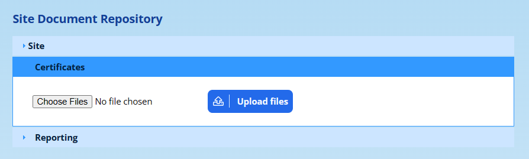
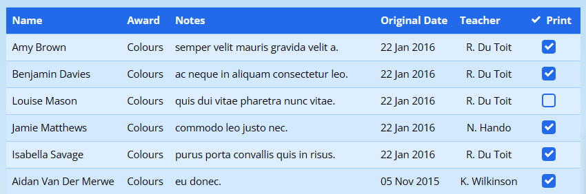

# Certificates

ADAM can print certificates for pupils in two ways:

-   **From Records and Points.** Where a Records and Points category has an attendance register, ADAM can print a certificate for each pupil who has a record in that category. See [Printing Certificates from Records and Points](#printing-certificates-from-records-and-points).
-   **As a one-off.** You choose the pupils by name and type the wording yourself, with no Records and Points record behind the certificate. See [Printing a One-off Certificate](#printing-a-one-off-certificate).

Both use a saved **certificate layout**. A layout says which background to print on, the page size, and where each piece of text goes. A school that prints more than one kind of certificate, such as a sport certificate and a cultural certificate, keeps one layout for each and chooses the right one every time it prints.

Printing never changes a layout. Two people can print different certificates at the same time without affecting each other’s positions.

## Permissions

Two permissions control certificates. Both are in the **Records and Points** section of the permissions list.

-   **Create certificates from Records and Points events** lets a staff member print certificates, both from Records and Points and as one-offs.
-   **Manage certificate layouts** lets a staff member add, edit, preview, disable and delete layouts.

When ADAM was updated to use certificate layouts, every group that already had **Create certificates from Records and Points events** was also given **Manage certificate layouts**. Remove it from any group that should only print.

To tick records for printing from Records and Points, a staff member also needs the **Add Records and Points** permission. Without it, the list of records is shown but nothing can be ticked.

## Uploading Certificate Templates

A certificate template is a PDF that ADAM prints the pupil’s details on top of. You do not need one: if you print onto pre-printed certificate stationery, leave the layout’s template as “No template”. With more and more awards being issued electronically, even for archival purposes, a template is useful for a purely electronic certificate that can be emailed.

Navigate to **Administration → Document Repository → View the Site Document Repository** and upload the PDF into the “Certificates” category. See [Site Document Repository](document-repository.md#site-document-repository).

Kindly note the following:

-   The certificates should be one of the standard sizes A4 or A5 (either portrait or landscape). Other sizes will be truncated to fit the size chosen in the layout.
-   The PDF document must be compatible with PDF Version 1.4 (Adobe 5). If you have a graphic designer working with your certificates, they should be able to export the template in this format for you. If you upload the certificate in a newer format, it *may* work, but it may give unpredictable results and errors.
-   Only PDF documents in the “Certificates” category are offered as templates. ADAM uses the first page of the PDF.

## Certificate Layouts

On the **Pupils** tab, under the **Records and Points Admin** heading, click on **Certificate layouts**. You need the **Manage certificate layouts** permission to see this option.

The **Edit Certificate Layouts** page lists every layout, with its **Layout name**, **Background template** and **Page size**.

To the right of each layout are these options:

-   **edit** opens the layout so that you can change it or preview it.
-   **disable** stops the layout being offered when certificates are printed. The layout is kept, and **enable** brings it back.
-   **delete** removes the layout permanently.

### Adding a New Layout

Click on **Click here to add a new certificate layout** at the top of the page. The same form is used to edit a layout.

-   **Layout name:** the name that staff choose from when they print, such as “Sport certificate” or “Cultural certificate”. A layout must have a name.
-   **Certificate Template:** the PDF that the text is printed on. The list shows the documents [uploaded to the “Certificates” category](#uploading-certificate-templates). Choose “No template” to print onto pre-printed certificates.
-   **Certificate Size (must match template):** **A4 Portrait**, **A5 Portrait**, **A4 Landscape** or **A5 Landscape**.

Below these are six blocks, one for each piece of text that ADAM can place on the certificate:

| Block | What is printed |
|---|---|
| **Name** | The pupil’s name. |
| **Award** | The name of the Records and Points category, or the award you type for a one-off certificate. |
| **Notes** | The notes on the Records and Points record, or the notes you type for a one-off certificate. |
| **Date** | The date you type when you print. |
| **Class** | The pupil’s class. |
| **Signature** | The school’s signature image. |

Each block has these settings:

-   **Show:** choose **No** to leave this piece of text off the certificate.
-   **Font**, **Font size** and **Colour:** how the text looks.
-   **Left** and **Top:** how many millimetres the box starts from the left and top edges of the page.
-   **Width** and **Height:** the size of the box, in millimetres.

The text is centred in its box and may overflow it. **Notes** behaves differently: long notes wrap onto as many lines as they need, and **Height** sets the height of each line rather than of the whole box.

The **Class** block also has a **Format** setting:

-   **Grade & Description (e.g. Grade 5 F)**
-   **Grade (e.g. Grade 5)**
-   **Description (e.g. F)**

The **Signature** block has no font or colour settings, because it prints an image. ADAM uses the **Default Report Signature**, which is chosen under **Administration → Site Administration → Edit site settings**, on the **Appearance** tab under the **Branding** heading. If no signature has been chosen there, the block is left empty.

When setting up a layout for the first time, it is often useful to draw some pencil boxes on a printed certificate where you expect the text to be displayed. Then measure the top left corner of each box (for the “Left” and “Top” measurements), as well as the box’s width and height.

Click on **Save layout** to save the layout.

### Previewing a Layout

Previewing prints one certificate from a saved layout using sample text, so that you can check the positions without finding real records.

Open the layout with **edit**, then click on **Preview this layout with sample text** at the top of the page.

The **Name**, **Class**, **Award**, **Notes** and **Date** fields are filled in with sample text. The sample notes are deliberately long, so that you can see how notes wrap. Change any of the text if you would like to check a real pupil’s name or a particular award, then click on **Print preview**. The certificate opens in a new tab.

The preview uses the layout as it was last saved. Save your changes before you preview them.

### Layouts Carried Over from Earlier Versions

Before certificate layouts were added, ADAM kept a single set of certificate settings for the whole school, and changed it every time someone printed. When your school was updated, those settings became a layout called “Certificate layout”. Rename it, or add further layouts alongside it.

Preview the carried-over layout before you next print from it. Two things may need correcting:

-   If the school never saved a position for a block, that block starts 150 mm from the top of the page and may overlap the name.
-   A font chosen several years ago under an older name, such as “Arial Bold”, has become plain Arial. Choose the bold font again.

## Printing Certificates from Records and Points

Certificates can be printed from any Records and Points category that has an attendance register. See [Adding a new Records and Points Category](records-and-points-administration.md#adding-a-new-records-and-points-category). ADAM lists the pupils who have a record in that category but have not yet been marked as having “attended”. In this context, “attended” could be read as being: “attending the awards ceremony”.

On the **Pupils** tab, under the **Records and Points Admin** heading, click on **Print certificates**.

1.  Choose the **Records and Points Category** and click on **Next**.
2.  Choose the **Date** and click on **Next**. The list shows the 30 most recent dates on which records were added in that category.

The **Printing Certificates** page lists the records for that date, together with any earlier records in the category for pupils who have not yet attended.

-   **Certificate layout:** choose the layout to print with. No layout is chosen for you, so that a sport certificate is never printed with a cultural layout by mistake. Staff with the **Manage certificate layouts** permission also see an **Edit certificate layouts** link here.
-   **Certification Date:** the date printed in the **Date** block. It starts as today’s date, and you can type any wording you like.

Below these settings is the list of records. Those that are ticked in the **Print** column will be printed:

Records for pupils who have already attended show the date and the staff member who marked them, and cannot be ticked. The **Class** block shows the pupil’s class on the date you chose.

Finally, click on the **Generate certificates** button to have ADAM compile the certificates for you. They open in a new tab, and can then either be printed or saved. You might also use a free online service to split the PDF into individual documents so that the certificates can be emailed individually.

Printing does not mark the pupils as having attended. Record that on the category’s attendance register as usual.

ADAM shows a message instead of certificates when:

-   no layout was chosen: “Please choose a certificate layout.”
-   the layout was disabled or deleted after the page was opened: “That certificate layout is no longer available.”
-   no records were ticked: “Please tick at least one record to print.”

If no layouts have been set up, the page says “No certificate layouts have been set up yet.” See [Adding a New Layout](#adding-a-new-layout).

## Printing a One-off Certificate

A one-off certificate is for an award that is not recorded in Records and Points, such as a prize at an inter-house event. You can print it for one pupil or for several at once. Nothing is recorded on the pupils’ profiles.

On the **Pupils** tab, under the **Records and Points Admin** heading, click on **Print a one-off certificate**.

-   **Certificate layout:** the layout to print with.
-   **Pupils:** type in part of a pupil’s name and choose the pupil from the list that appears. Repeat for each pupil. Because each name comes from the pupil’s record, it is spelt exactly as ADAM has it.
-   **Award:** the wording for the **Award** block, such as “Best Actor”.
-   **Notes:** the wording for the **Notes** block. This can be left empty.
-   **Date:** the date printed in the **Date** block. It starts as today’s date.

Click on **Generate certificates**. ADAM prints one certificate for each pupil, all with the same award, notes and date, in a new tab. The **Class** block shows each pupil’s current class.

If no layout or no pupil was chosen, ADAM shows a message saying so instead.
