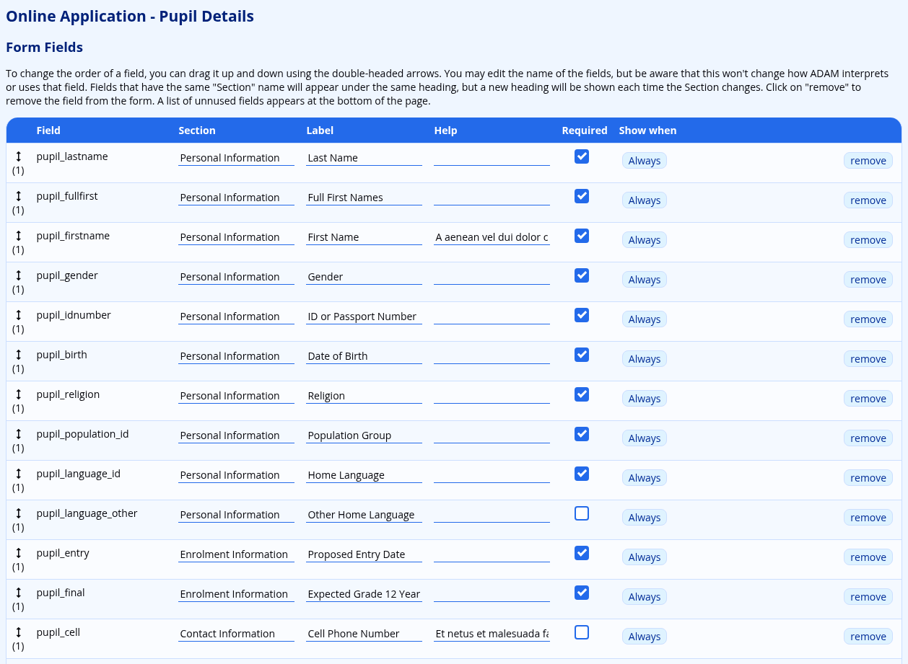
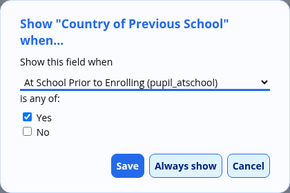
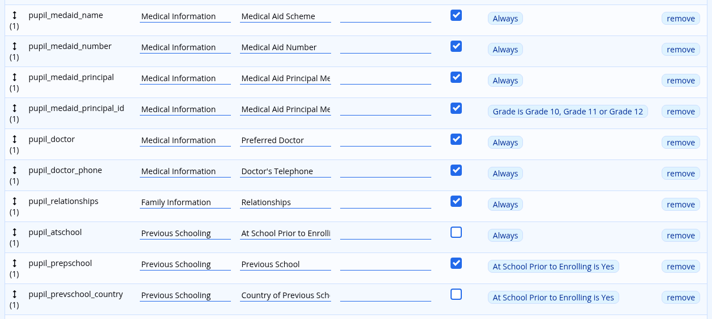

# Database Field Management

While the fields in ADAM are reasonably standard, there might be reason for a school to want to edit the headings and order of the fields. Some schools may choose not to use certain fields and would like to streamline the interface so that only the necessary fields appear.

## Sensitive Information

With the arrival of the Protection of Personal Information (POPI) Act in the near future, schools must be able to take responsible care of the data that they are entrusted with.

To manage sensitive information fields, please visit **Administration → Database Administration → Manage personal information fields**.

You can manage personal information for Pupils, Staff and Families. Note carefully that this setting is used to ensure that these fields are erased when the information is no longer relevant. This should include, as examples, medical information and contact information. However, you should **not** set fields such as Names here since they will be erased and you will have unidentifiable information stored in your database. This is problematic from an archival perspective since if you are requested for historical educational records, you won’t have a way to access it.

Tick the fields that you consider to be sensitive and then click on the **Save** button at the bottom of the screen.

## Managing Custom Database Fields

It is possible to store any other information you wish in ADAM which is not catered for by the core database fields. You can create custom fields for each of the pupils, staff and family data types.

Before you create a new custom field, please speak to the development team to see if it would be best served if that field was a part of the core data!

The options for managing the custom database fields are found on the **Administration** tab under the **Database Administration** heading. Click on **Manage custom data fields** to begin.

### Adding a new custom field

At the top of the table of fields is an option to **Add a new custom field…**. Click on this link to begin the process.

-   Table: Choose which database table the information belongs with. If you wish to have it with more than one table, you will have to add a custom field for each table.
-   Field Category: This is the heading under which the field will appear. If the category matches one of the core database fields’ categories (see above), then the custom field will appear at the end of that category in data capture screens.
-   Field Name: Type in the name that should appear next the field on data capture screens.
-   Field Type: Choose what sort of information is to be stored in this field. The different options are explained:

-   Text box: This is a straightforward text entry box. Nothing fancy happens!
-   Text box with recall: This textbox will suggest options based on previously entered options.
-   Long text box: This text box will provide a number of lines for text entry. This is useful for longer notes or paragraphs of text.
-   Date: this field will store a date. A date-picker will automatically be shown for this field.
-   Single Option: A user will choose one out of several possible options that are shown.
-   Multiple Option: A user will choose many out of several possible options that are shown.

-   Field Parameters: This is only used for the “Single Option” and “Multiple Option” field types. List the options that you wish to have available to the users. Do not leave any blank lines since this will make a blank option available. Any duplicates will be ignored.
-   Default Value: What value should ADAM assume for any fields that have not yet been updated with an actual value? If you are working with a “Single Option” or “Multiple Option” field, the default value must be one of the options provided.
-   Sort order: This determines the order in which the custom fields are sorted. Lower numbers mean earlier in the list. If two fields have the same number, they are sorted by their field names.
-   Show for Scratch List: Should this field be made available on the scratch list options?
-   Sensitive Information: Should the contents of this field be made available to staff who do not have the permissions to see sensitive information?
-   Show on the Detail Update Form: Should this field appear on a detail update form?

Note that custom fields are always available on “Add” and “Edit” operations.

**Save** the field once you are finished.

You will need to [add your custom data field to one or more input forms](#managing-data-input-forms) for it to be useful.

### Editing custom fields

You can edit any custom field by clicking on the **edit** link next to its entry. A description of the fields is [provided above](#adding-a-new-custom-field).

### Deleting custom fields

It is possible to delete the custom field. Note that the table shows the number of times the field has been used. If you delete a custom field, you will lose ***all*** the information that it contained.

## Managing Data Input Forms

ADAM has a number of core and custom fields that can be customised. To manage the fields that are present, including adding fields, removing fields and determining which fields are mandatory, navigate to **Administration → Database Administration → Manage Input Forms**.

A list of customisable input forms will be displayed:

Each form has an audience (internal vs external) which tells you whether the action is going to be performed by a staff member (which would be considered *internal*) or a parent (which would be considered *external*).

Click on the **edit** button next to the form you would like to customise.

For each field, ADAM shows the internal field name, a Section header, a Label, Help and whether the field is required or not. You can also drag the  icon in order to change the ordering of the fields, and click on the **remove** button to remove the field from the form.

-   The **Section** is the header that the fields appear under. All the fields in a single section should be ordered together here. You can use any section names that you’d like.

-   ADAM will display fields in the order shown here, regardless of the Section that you put them in. ADAM puts in a new Section heading on the form whenever it sees the Section change. It does not keep track of what sections are already shown and so if you mix the fields up, you may end up with the same heading being repeated in the form.

-   The **Label** is the heading that would appear on the left of the form.

-   While you can change the wording to anything you’d like, please note that changing the name of the field does ***not*** change its function and, especially, will not change how ADAM treats the field. If you want a field that isn’t present in the list of fields, you will need to add a new field first.

-   The **Help** text appears in grey writing on the right-hand side of the form and provides guidance to the user about completing the field.

-   Again, this text can be customised to contain any information you want, but once more it is important to realise that this will not change how ADAM treats and interprets the field.

-   The **Required** tick box will tell ADAM whether the value must be entered or not. The user will not be able to submit the form if they have not captured any data. A field that a [**Show when** rule](#show-when-rules) has hidden is never required.
-   The **Show when** column appears only on the forms that parents fill in. It lets you ask a question only when an earlier answer calls for it, and is described [below](#show-when-rules).
-   ADAM allows for fields to be removed from the form by clicking on the **remove** button next to the field.

-   Please be careful about removing fields that ADAM requires. Removing important fields can have deleterious consequences. Please reach out to the ADAM support for guidance if you are not sure.

At the bottom of the page is a list of fields that can be added to the form.

Click on the **add** button and drag the field into the correct position on the form.

Click on **Save form information** when done.

### Creating a new external form

ADAM ships with one form for each purpose, but a school can create further external forms — for example a short pupil form that asks only for medical information, for use in a [detail update profile](family-detail-updates.md#configuring-an-update-profile).

Click on **Create New External Form** at the top of the list of forms. Type a **Form Name** and an optional **Description**, choose the **Table** the form belongs to (**Pupils**, **Families** or **Staff**), and click on **Create Form**. ADAM copies every field from the matching default update form — **Online Update - Pupil Details**, **Online Update - Family Details** or **Update Personal Staff Details** — including its sections, labels, help, **Required** settings and **Show when** rules. Then edit the new form as described above.

A form that your school created shows a **delete** button in the list, as long as no detail update profile uses it. ADAM’s own forms cannot be deleted.

### Showing a field only when it applies { #show-when-rules }

Some questions only make sense for some children. Questions about a child’s previous school matter only if the child was at school before, and a study permit number matters only if the child needs a study permit. A **Show when** rule tells ADAM to ask a question only when an earlier answer on the same form calls for it. Until then the question is hidden.

**Show when** rules are available only on the external pupil and family forms — the forms that parents fill in:

-   **Online Application - Pupil Details** and **Online Application - Family Details**, used by [online applications](online-applications.md#customising-the-application-form);
-   **Online Update - Pupil Details** and **Online Update - Family Details**, used by [detail updates](family-detail-updates.md#customising-the-detail-update-forms); and
-   any pupil or family form that your school has [created](#creating-a-new-external-form).

The forms that staff use, and the staff update form, do not show the **Show when** column.

#### Setting a rule

1.  Click on **edit** next to the form. Every field shows **Always** in the **Show when** column until it is given a rule.
2.  Click on **Always** next to the field that should only sometimes be asked. A dialog opens.
3.  Under **Show this field when**, choose the field whose answer decides. Each field is listed by its label, followed by its internal name in brackets, for example **At School Prior to Enrolling (pupil_atschool)**.
4.  Under **is any of:**, tick every answer for which the field should be shown.

    

    *Country of Previous School will be asked only when the parent answers Yes to At School Prior to Enrolling.*

5.  Click on **Save**. The **Show when** column now describes the rule in words, for example *At School Prior to Enrolling is Yes* or *Grade is Grade 10, Grade 11 or Grade 12*.
6.  Click on **Save form information**. The rule is not stored until you do.

    

    *Previous School and Country of Previous School depend on At School Prior to Enrolling, and the medical aid principal member’s ID is asked only for Grades 10 to 12.*

To remove a rule, click on its description and then on **Always show**. **Cancel** closes the dialog without changing anything.

#### Which fields can decide

Only a field with a fixed list of answers can decide whether another field is shown. Examples are **Gender**, **Home Language**, **At School Prior to Enrolling**, **Requires Study Permit**, the grade, and custom fields of the **Single Option** or **Multiple Option** type. A text box or a date cannot decide.

The deciding field must be on the same form, in the **Form Fields** table. A field cannot depend on itself.

-   **The grade** is always listed as **Grade**, whatever label it has on the form. On an application form it is the **Grade of Entry** that the parent chooses for the child. On an update form it is the child’s current grade.
-   **A Multiple Option field** shows the dependent field if *any* of the parent’s chosen answers is one that you ticked.
-   **Rules can follow on from each other.** A field can depend on a field that has a rule of its own. If the first field is hidden, every field that depends on it is hidden too. ADAM refuses rules that go round in a loop, where a field ends up depending on itself.

Each field can have one rule, based on one deciding field. That rule can list as many answers as you like.

#### What parents see

A field with a rule appears and disappears as soon as the parent changes the deciding answer. When every field in a section is hidden, the section’s heading is hidden as well.

A hidden field is never required, even if its **Required** box is ticked, so it never stops a parent from submitting the form. Once the field is shown, it is required as usual.

What happens to an answer in a field that becomes hidden depends on the form:

-   **Online applications.** When the parent saves the page, ADAM discards any answer in a field that is hidden at that moment. The staff screen for checking and accepting an application applies the same rules.
-   **Online detail updates.** A hidden field is not sent with the form, so the review screen shows no change for it. The value that ADAM already holds is kept.
-   **Printed detail update forms.** Paper cannot hide a question, so every field is printed. A field with a rule has its condition added after its label, for example *Country of Previous School (only if At School Prior to Enrolling is Yes)*.

#### When a rule cannot be saved

ADAM checks every rule when you click on **Save form information**. If a rule cannot work, ADAM saves nothing, returns you to the form as it was last saved, and shows a message that names the field and the problem. The most common causes are:

-   the deciding field has been removed from the form;
-   a ticked answer is no longer one of the deciding field’s answers; or
-   two or more rules depend on each other in a loop.

ADAM will not let you click on **remove** for a field that other fields depend on. It shows a **Field in use** message that names those fields instead. Change or clear their rules first.

If a field’s rule depended on a field that is no longer on the form — or on answers that no longer exist — the **Show when** column reads *Always (its rule depended on an answer no longer on this form)*. Parents are shown that field every time. The old rule is cleared the next time you click on **Save form information**. When only some of a rule’s answers have been removed, ADAM keeps the rule with the answers that remain.

#### Limits

-   A field cannot depend on an answer on a different form. On an online application the parents’ details and each child’s details are separate forms, so a question about a child cannot depend on a parent’s answer.
-   Each field has one rule. A rule cannot combine two deciding fields, and it cannot say “show unless”. To show a field for every answer except one, tick all the other answers.

## Managing Scratch List Fields

The options for managing the scratch list fields are found on the **Administration** tab under the **Database Administration** heading. Click on **Manage scratch list fields** to begin.

Choose which type of scratch list fields you want to manage and click on the **edit** button.

-   Ordering the fields: If you wish to change the order that the fields are displayed in, you can do so by dragging the  icon up and down.
-   Field description: If you wish to change the field name that is displayed, you can do so. If the field name is removed entirely, ADAM will restore the default field name.
-   Category: ADAM will group the fields under different headings as specified.
-   Each field has three options:

-   Enabled: this setting determines whether the field is available or not to all users.
-   Sensitive: this setting determines whether the field is available to users with or without the sensitive information permission. Note that if a field is not set as sensitive here, but is based on a sensitive field as defined in the core database fields, ADAM will allow the field to be selected, but it will not show any information.
-   Hidden: In an attempt to simplify the scratch list options, some options can appear hidden at first. If there are any hidden fields, ADAM will show an option to toggle the hidden fields on and off.

Once you’re done editing these options, click on the **Save** button at the bottom of the screen.

### Restoring the Default Settings

Every scratch list field has a set of default settings — its name, its category, its position in the
list and its three options — that ADAM ships with. Anything you change on this screen is stored as
*your school’s customisation* of that field, sitting on top of those defaults.

That means a customisation can always be undone:

-   To restore a **single field**, click on the **Reset** button at the end of its row. ADAM asks you
    to confirm, and then restores that field’s name, category and options to the shipped defaults.

    

-   To restore **every field of this type at once**, click on **Restore all defaults** at the bottom
    of the screen. This discards every customisation for the fields on this screen, so ADAM asks you
    to confirm before doing it.

    

Neither option deletes any pupil, family or staff information — they only affect how the fields
themselves are named, grouped and offered.

> [!NOTE]
> Because only genuine customisations are stored, improvements that ADAM makes to a field’s default
> name now reach your school automatically, instead of being masked by a stored copy of the old
> name. If a field is showing a name your school has never chosen — an old or plainly wrong one —
> resetting that field is the quickest way to pick up the corrected default.
