# Logging on to ADAM: A Guide for Parents

**In order to protect the privacy and security of personal information in ADAM, parents are required to set a password that will be used in conjunction with their ID number in order to log into ADAM. This document explains how to do this.**

There are several sections in this document. The following links will jump you to the appropriate section depending on what you’re trying to do:

1.  [Logging into ADAM for the first time](#logging-into-adam-for-the-first-time)
2.  [Logging into ADAM on subsequent occasions](#logging-into-adam-on-subsequent-occasions)
3.  [Help! I’ve forgotten my password!](#help-ive-forgotten-my-password)
4.  [Help! ADAM doesn’t recognise my information!](#help-adam-doesnt-recognise-my-information)
5.  [Help! ADAM says my profile has not been granted access to any pupil information!](#help-adam-tells-me-that-no-information-is-permitted-to-be-shown)

## Logging into ADAM for the first time

Before you begin:

1.  You must know your **South African ID number** or your **passport** number, as captured on the ADAM database.
2.  You must also have access to an **email address** that is entered against your name in the database. Part of the process will involve ADAM sending a link to your email address. You must use the link within 24 hours of requesting it.

> [!NOTE]
> Some parents who share a single email address may have difficulty in accessing ADAM. This is because the email address is likely to be linked to only one parent. If the email does not arrive, please make contact with the school, who can add the address for both parents.

Proceed to “Parent Login” on the ADAM home page:

Click on the button that says “**New account? Forgotten password?**”:

You will then be asked to enter your ID number. Enter it with no spaces. Parents who are not South African citizens should enter their passport numbers here. Then click on the “**Send me a reset link**” button.

ADAM returns you to the “Parent Login” page and shows a message in the bottom corner of the screen: “A password reset link has been sent to all email addresses that are linked to the ID number.”

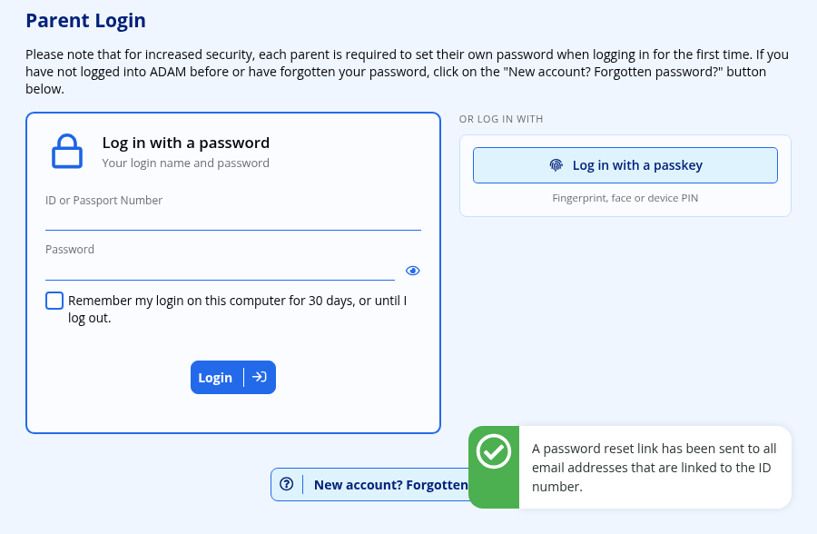

ADAM shows this message whether or not it found your ID number. This protects parents’ privacy: nobody can use this page to find out who has an account. If the email does not arrive, see [Help! ADAM doesn’t recognise my information!](#help-adam-doesnt-recognise-my-information)

Please check your email for a mail that looks similar to the one below. Be sure to check your junk or spam folder for the email!

Please note that if you do not follow this step within 24 hours of requesting the new password, the link will expire and you will need to start again. The link can also only be used once: as soon as you have set your password the link stops working, so if you ever need to reset your password again you must request a fresh link. Please also note that the password reset link is specific to an individual parent and the same link cannot be used to reset another parent’s password.

> [!NOTE]
> If you click a reset link that has expired or that you have already used, ADAM will tell you that the link may have expired. Simply return to the “Parent Login” page, click “**New account? Forgotten password?**” again, and ADAM will email you a new link.

When you click on the link, you will be prompted to enter a password, twice:

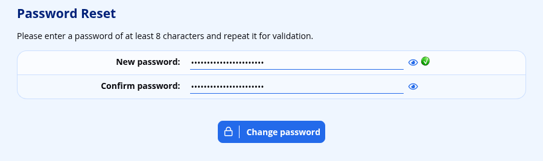

After you enter your password, ADAM will perform a security check on your password to ensure that it is of sufficient quality. ADAM will show a green check mark next to the password field if the password is satisfactory.

If the password is not secure, ADAM will show a warning, asking you to choose a more secure option:

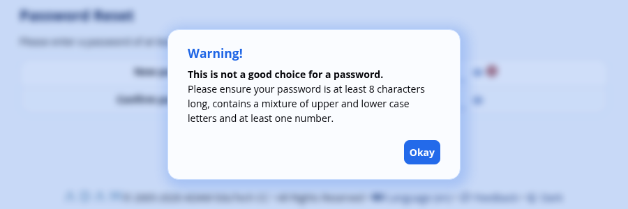

Click on the “**Change password**” button. ADAM returns you to the “Parent Login” page and confirms that your password has been changed.

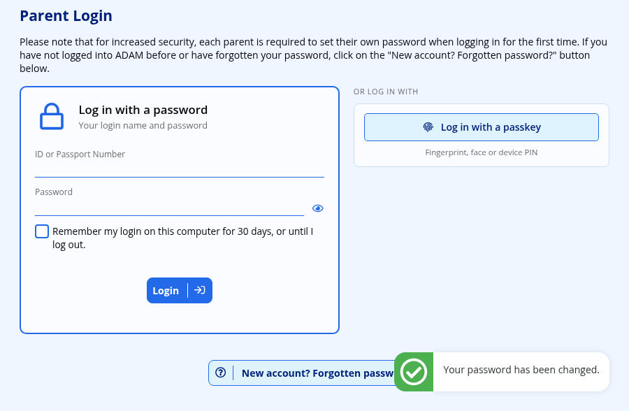

You can now log in with your ID number and your new password.

## Logging into ADAM on subsequent occasions

Proceed to “Parent Login” on the ADAM home page:

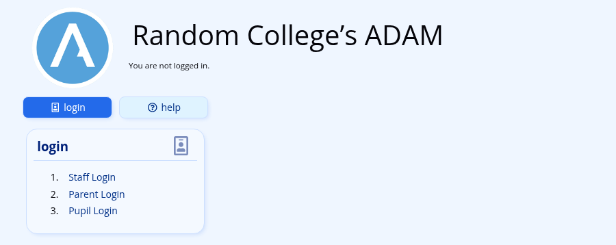

Enter your ID number, with no spaces, and your password. Parents who are not South African citizens should enter their passport numbers instead of an ID number. Then click on the “**Login**” button.

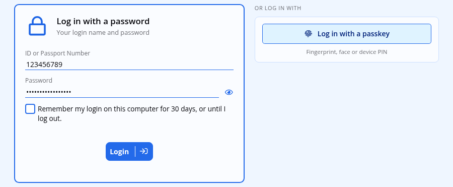

If the school allows it, the page also shows a “Remember my login on this computer” option. If you tick it, ADAM keeps you logged in on that computer for the number of days shown, or until you log out. Do not tick it on a computer that other people use.

If you are successfully logged in, you will see a login status message at the top of the screen and a card for each of your children will be shown.

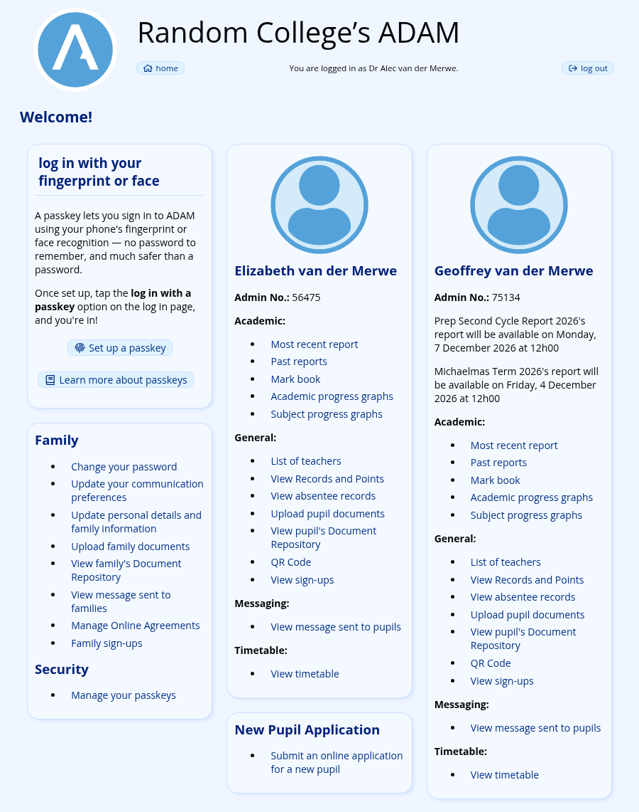

You may find that ADAM tells you that your profile has not been granted access to any pupil information. In this instance, please see the section titled [Help! ADAM says my profile has not been granted access to any pupil information!](#help-adam-tells-me-that-no-information-is-permitted-to-be-shown)

## Logging in with a Passkey

If your phone, tablet or laptop supports a fingerprint reader, face recognition, or a screen-lock PIN, you can choose to log in with a passkey instead of typing your ID number and password. A passkey is a small piece of information that lives on your device. To log in, you simply tap a button on the ADAM log-in page and confirm with your fingerprint or face — ADAM never sees your fingerprint or face, only the “yes, this is the right person” answer from your device.

To set up a passkey, log in with your ID number and password as usual. At the top of your portal page, ADAM will display a card titled “**Log in with your fingerprint or face**” with a **Set up a passkey** button. Click it, then click **Register a new passkey**, and confirm with your device’s fingerprint, face or PIN. The card appears whenever you log in with your ID number and password rather than a passkey, so you may still see it on a device where you have not yet added a passkey.

From then on, when you visit the parent log-in page, you can click **Log in with a passkey** instead of entering your ID and password. The button is only shown when your browser supports passkeys; if it is not visible, just continue to log in with your ID number and password as before.

To rename or remove a passkey at any time, go to **Family Portal → Security → Manage your passkeys**. Remove a passkey if you have lost the device it was set up on, or if you no longer use that device for ADAM. See [Passkeys: A Guide for Parents and Pupils](passkeys-a-guide-for-parents-and-pupils.md#passkeys-a-guide-for-parents-and-pupils) for the full guide.

## Help! I’ve forgotten my password!

If you have **forgotten your ADAM password**, you can get ADAM to send you a password reset link similar to the one you received when you first created your password.

Click on the “Parent Login” option on the landing screen:

Click on the “**New account? Forgotten password?**” button:

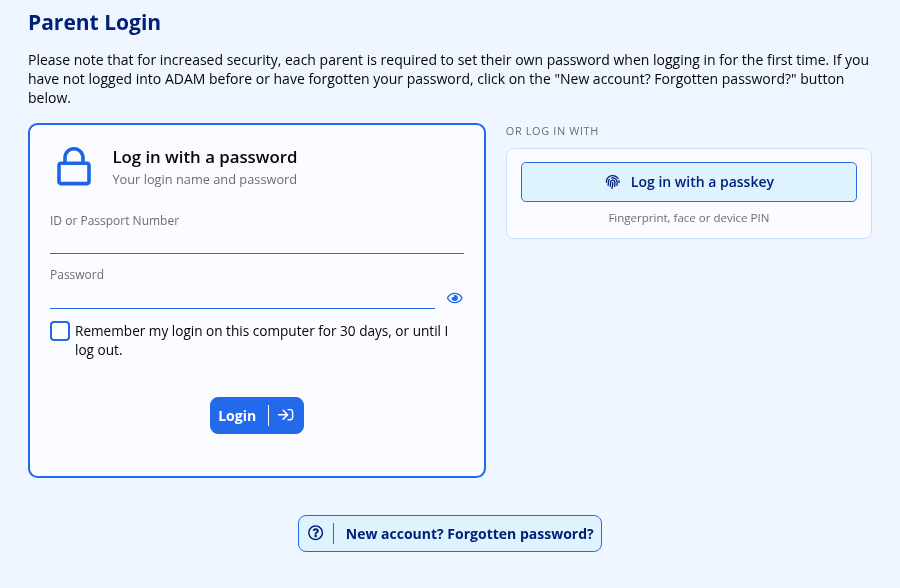

Then enter your ID number and click on the “**Send me a reset link**” button.

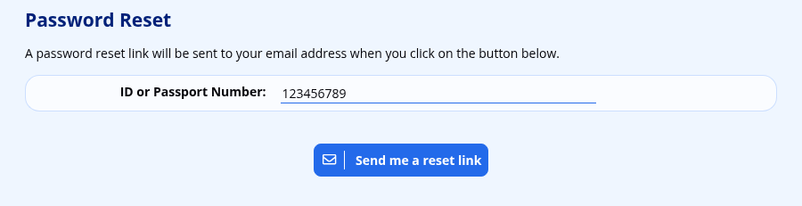

ADAM will then send you a password reset email. Please allow 5 to 10 minutes for the email to arrive. If it does not arrive, please also check your junk or spam mail folder. If you request several links in a few minutes, ADAM asks you to wait 5 minutes before you try again.

In the email is a link that you can click on which will take you back to ADAM and you can then enter a new password. This link is valid for 24 hours and can only be used once. If the link has expired, or if you have already used it to set a password, request a new reset link and ADAM will email you a fresh one.

> [!NOTE]
> If you know your password and simply want to change it, log in and click on “**Change your password**” under “Family” on your portal page.

## Help! ADAM doesn’t recognise my information!

ADAM does not tell you whether it found your ID number. If your ID number or email address is not recorded correctly, you will notice one of two things:

-   You request a reset link, but no email arrives, even after you have checked your junk or spam folder.
-   When you log in, ADAM shows the message “The username and password are not a valid combination.”

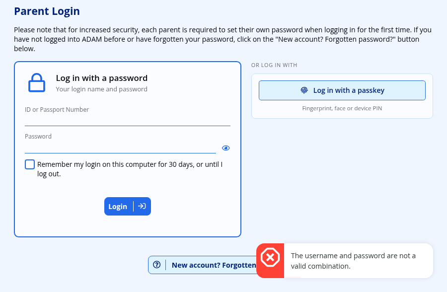

The same message appears when the password is wrong, so first check that you typed your ID number with no spaces, and try resetting your password. After several failed attempts, ADAM asks you to wait a few minutes before you try again.

If this does not help, you will need to contact the school and ask them to double check your ID number and email addresses on the system. In many cases, the database will have your details with a simple typographical error.

Kindly note that the developers of ADAM cannot assist with the resolution of this issue.

## Help! ADAM says my profile has not been granted access to any pupil information! {#help-adam-tells-me-that-no-information-is-permitted-to-be-shown}

Parents may see this message after logging in: “You have successfully logged in to … but your profile has not been granted access to any pupil information. Kindly contact the school to resolve this matter.”

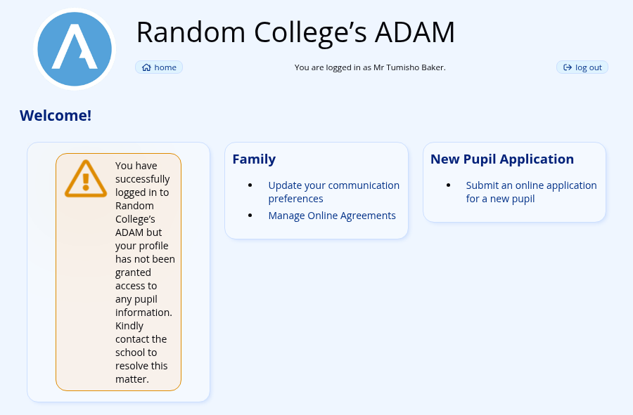

In this instance, the school has not given your profile access to your children’s information on ADAM. The reasons for this are varied. To resolve this issue, you must please make contact with the school.

Kindly note that the developers of ADAM cannot assist with the resolution of this issue.
