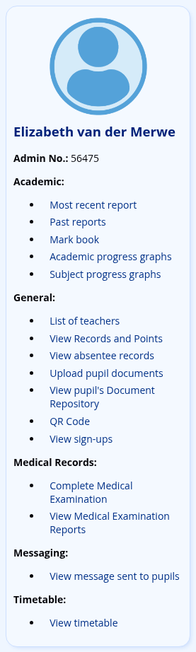

# Medical Examinations: A Guide for Parents and Pupils

**Your school may ask you to fill in a medical examination on the ADAM portal. This is a short form the school sets up, such as a health screening questionnaire or a record of a measurement. This guide explains where to find the form, how to complete it, and how to see the results afterwards.**

There are several sections in this document. The following links will jump you to the appropriate section depending on what you’re trying to do:

1.  [Finding medical examinations on the portal](#finding-medical-examinations-on-the-portal)
2.  [Completing a medical examination](#completing-a-medical-examination)
3.  [After you submit](#after-you-submit)
4.  [Viewing medical examination results](#viewing-medical-examination-results)
5.  [Help! I can’t see the medical examination options!](#help-i-cant-see-the-medical-examination-options)
6.  [Help! I made a mistake on a form I submitted!](#help-i-made-a-mistake-on-a-form-i-submitted)

## What a medical examination is

A medical examination in ADAM is a form that your school designs. Each one asks a set of questions or records a set of measurements. One school might use it for a daily health check before pupils arrive at school. Another might use it to collect a height or weight reading. The questions, and the instructions at the top of the form, come from your school and differ from school to school.

Each examination you complete is saved on the pupil’s medical records at the school. An examination is always about a pupil. You cannot record one about a parent.

## Finding medical examinations on the portal

Log in to the portal first. If you need help with this, see [Logging on to ADAM: A Guide for Parents](logging-on-to-adam-a-guide-for-parents.md#logging-on-to-adam-a-guide-for-parents).

The medical examination options sit under the **Medical Records** heading on the pupil’s card on the portal’s main page. There are two options, and your school decides which of them you see:

-   **Complete Medical Examination** opens a form for you to fill in.
-   **View Medical Examination Reports** shows the results recorded so far.

### If you are a parent

Your portal shows a separate card for each of your children. Find the card for the child concerned and look under its **Medical Records** heading. Each child’s card shows only the options the school allows for that child, so you may see the options on one child’s card and not on another’s.

### If you are a pupil

Your portal shows one card: your own. Look under its **Medical Records** heading. Your school may let parents complete examinations but not pupils, so the options may be missing from your card even if your parents can see them.

## Completing a medical examination

1.  Under the **Medical Records** heading, click **Complete Medical Examination**. ADAM opens the **Pupil Medical Examination** page.
2.  If the school has more than one examination available, choose the one you need from the **Medical Examination** list and click **Next**. If the school has only one, ADAM skips this step and opens the form straight away.

    

3.  Read the top of the form. Under the examination’s name, ADAM tells you when information was last saved for this examination (for example, “58 minutes ago”). If nothing has been saved yet, it says “No recent information for this medical examination has been recorded.” Check this before you carry on, so that you do not submit the same examination twice by mistake.
4.  Read the **Instructions**. Your school writes these, and they tell you what the school needs from you.
5.  Answer every question. Some questions are a choice of answers, and others need a number or a short piece of text. The unit, such as “cm” or “°C”, appears next to the box where it applies.
6.  If you have anything else to tell the school, type it in **Other notes**. This box is optional.
7.  Click **Save Examination**. The button stays greyed out until you have answered every question.

The form above is an example only. Your school’s form will have its own name, instructions and questions.

## After you submit

ADAM shows the message “The medical examination information has been saved.”

The examination is saved on the pupil’s medical records with today’s date, where the school’s staff can see it. If your school has set this up, ADAM also emails the results to particular staff members as soon as you submit.

Click **Back to the main page** to return to the portal’s main page.

## Viewing medical examination results

Under the **Medical Records** heading, click **View Medical Examination Reports**.

The page shows a heading for each examination that your school has chosen to show on the portal. Under each heading is a table of the pupil’s five most recent examinations of that kind, newest first, with these columns:

-   **No.**: the examination’s place in the list.
-   **Date**: the date the examination was recorded, with the time underneath.
-   **Type**: the name of the examination.
-   **Data**: each question or measurement, with the answer that was recorded.
-   **Notes**: anything typed in the notes for that examination.

Below the table, under **Graphs**, ADAM shows graphs of the pupil’s readings over time, such as height or weight. If there is nothing to graph, ADAM shows “(No graphs to display)”.

The results include examinations recorded by school staff, not only the ones completed on the portal.

## Help! I can’t see the medical examination options!

If there is no **Medical Records** heading on the pupil’s card, or the option you need is not under it, your school has not turned it on for you. Schools decide separately whether parents and pupils may complete examinations and whether they may view results. Please contact the school.

If you click **Complete Medical Examination** and ADAM shows “There are no medical examinations available for completion.”, the school has not made any examination available on the portal at the moment. Please contact the school if you expected to see one.

Kindly note that the developers of ADAM cannot assist with the resolution of this issue.

## Help! I made a mistake on a form I submitted!

You cannot change or delete an examination once you have submitted it. Submitting the form again adds a second examination rather than replacing the first. Please contact the school and tell them what needs correcting.
