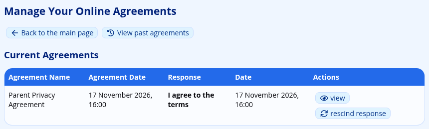
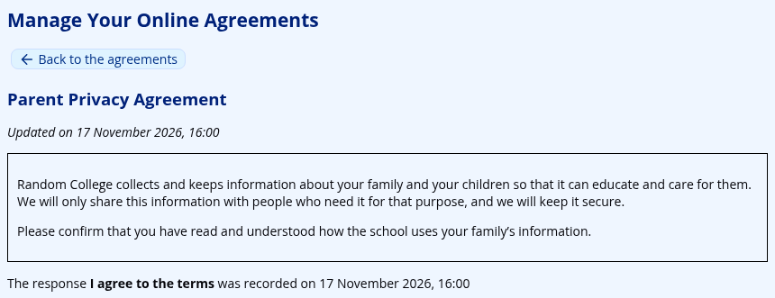
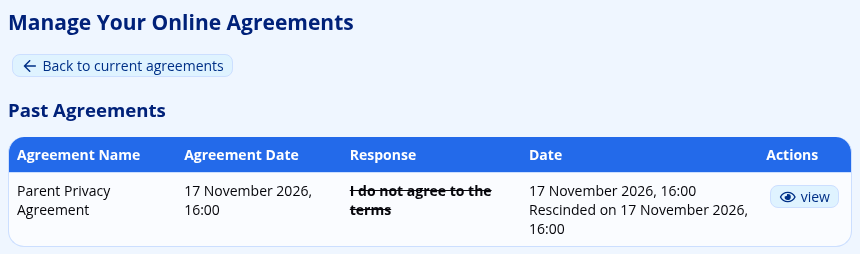
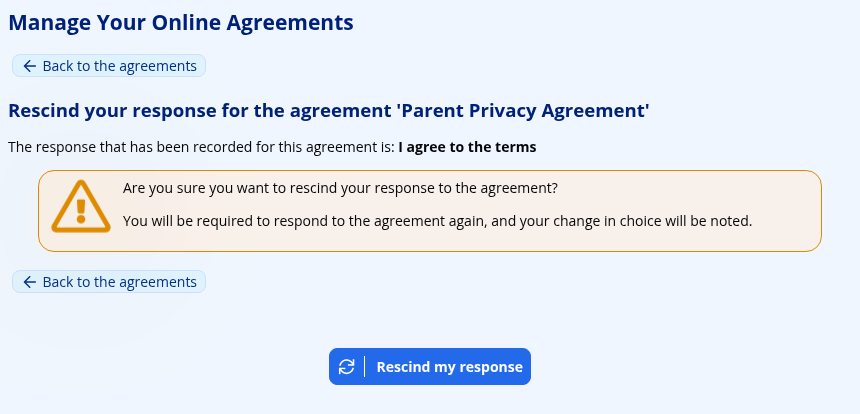

# Online Agreements: A Guide for Parents and Pupils

**Your school may ask you to read and respond to online agreements in ADAM, such as terms of enrolment, a privacy notice or a code of conduct. This guide explains why ADAM asks you, how to respond, and how parents can view or change their responses later.**

There are several sections in this guide. The following links will jump you to the one you need:

1.  [Why ADAM asks you to respond](#why-adam-asks-you-to-respond)
2.  [Responding to an agreement](#responding-to-an-agreement)
3.  [Viewing your responses](#viewing-your-responses)
4.  [Changing your response](#changing-your-response)
5.  [Help! I don’t want to agree!](#help-i-dont-want-to-agree)
6.  [Help! ADAM asks me to respond to an agreement I have already answered!](#help-adam-asks-me-to-respond-to-an-agreement-i-have-already-answered)
7.  [Help! I can’t see the rescind response option!](#help-i-cant-see-the-rescind-response-option)

## Why ADAM Asks You to Respond

When you log in to the portal, ADAM checks whether the school has any agreements that you have not yet answered. If there are, ADAM shows you those agreements before it shows you anything else. You cannot see the main portal page, or your children’s information, until you have responded to every outstanding agreement. ADAM checks again every time you return to the main portal page.

This applies to parents who log in with **Parent Login** and to pupils who log in with **Pupil Login**. The school decides which agreements each person is asked to respond to. For example, an agreement may be meant only for the families of pupils in a particular grade.

If ADAM also needs you to change your password, it asks you to do that first. After the agreements, the school may also ask parents to check their family’s details.

If your school emails you a link to update your family’s details, ADAM shows you any outstanding agreements before it shows you the update form.

> [!NOTE]
> ADAM records one response for each family. If the other parent on your family’s profile has already responded to an agreement, you will not be asked to respond to it again, and you will see their response in your list of agreements.

If you are applying for a place for a new pupil, the school may also ask you to respond to agreements during the online application. See [Online Applications: A Guide for Parents](online-applications-a-guide-for-parents.md) for that process.

## Responding to an Agreement

ADAM shows one agreement at a time. At the top of the page is the name of the agreement and the **Date** on which the school last updated it. The text of the agreement follows. Read it carefully: you may need to scroll to see all of it.

At the bottom of the page are one or more buttons. Click the button that matches your response. The buttons you see depend on how the school set up the agreement:

-   **Only one button.** If the school requires you to accept the agreement, there is a single button: **I agree to the conditions stated above.** You cannot decline this agreement in ADAM. See [Help! I don’t want to agree!](#help-i-dont-want-to-agree) if you do not wish to accept it.
-   **An agree button and a decline button.** You may choose either **I agree to the conditions stated above.** or **I DO NOT agree to the conditions stated above.**
-   **The school’s own responses.** Some agreements offer a list of responses written by the school. The first, highlighted button is the response the school expects most people to choose, but you may choose any of them.

When you click a button, ADAM saves your response. If you have another agreement to answer, ADAM shows it next. Once you have answered them all, ADAM takes you to the main portal page.

> [!NOTE]
> If you open an agreement and leave without responding, the school can see that you have viewed it but not yet responded. ADAM will show you the agreement again the next time you go to the main portal page.

If the school has chosen to send copies of an agreement, ADAM emails you a copy of the agreement and your response. Parents who do not want these emails can turn them off under the **Family** heading, by clicking **Update your communication preferences** and changing the **Online Agreements** option, if the school allows it.

## Viewing Your Responses

> [!NOTE]
> This section is for parents. Pupils cannot view their responses after they have answered. If you are a pupil and need to know how you responded, contact the school.

On the main portal page, under the **Family** heading, click **Manage Online Agreements**.

ADAM shows the **Manage Your Online Agreements** page. The **Current Agreements** table lists each agreement your family has responded to, with the **Agreement Date**, your **Response** and the **Date** on which you responded.

To read an agreement again, click **view** next to it. ADAM shows the text of the agreement and the response that was recorded, with the date and time. Click **Back to the agreements** to return to the list.

To see older responses, click **View past agreements** at the top of the page. The **Past Agreements** table lists:

-   responses that you have rescinded, shown crossed out, with the date on which you rescinded them; and
-   responses to agreements that the school has since replaced with a new version or withdrawn.

Click **view** to read any of these. Click **Back to current agreements** to return to the first list.

## Changing Your Response

> [!NOTE]
> This section is for parents. Pupils cannot change their responses in ADAM. If you are a pupil and want to change a response, contact the school.

The school decides whether you may change your response to each agreement. If it allows you to, a **rescind response** link appears next to the agreement in the **Current Agreements** table. To rescind means to withdraw the response you gave so that you can respond again.

1.  Under the **Family** heading, click **Manage Online Agreements**.
2.  Next to the agreement, click **rescind response**.
3.  ADAM shows the response you gave and asks: “Are you sure you want to rescind your response to the agreement?”

    

4.  Click **Rescind my response** to confirm, or click **Back to the agreements** if you have changed your mind.
5.  ADAM shows the message “Your response has been rescinded. You will be prompted to respond again when you return to the main menu.”
6.  Go back to the main portal page. ADAM shows you the agreement again so that you can give your new response. See [Responding to an agreement](#responding-to-an-agreement).

> [!WARNING]
> You cannot use the portal until you have responded to the agreement again. If the agreement requires you to accept it, your only option will be to agree again.

Rescinding does not erase your earlier response. ADAM keeps it in your **Past Agreements** list, crossed out, with the date on which you gave it and the date on which you rescinded it. The school can also see your earlier response, when you gave it, when you rescinded it, and your new response. You cannot change or delete these records.

Because ADAM records one response for each family, rescinding a response also rescinds it for the other parent on your family’s profile.

## Help! I don’t want to agree!

If an agreement shows only the **I agree to the conditions stated above.** button, the school requires everyone in that group to accept it before they can use the portal. ADAM does not let you decline it.

If you do not wish to accept the agreement, or you have questions about it, contact the school.

Kindly note that the developers of ADAM cannot assist with the content of a school’s agreements.

## Help! ADAM asks me to respond to an agreement I have already answered!

There are three usual reasons for this:

-   **The school has changed the agreement.** When the school changes the text of an agreement, ADAM treats it as a new agreement and asks everyone to respond again. Even a small correction counts as a change. Parents can find their response to the earlier version under **View past agreements**.
-   **Someone rescinded the response.** If you, or the other parent on your family’s profile, rescinded the response, ADAM asks your family to respond again.
-   **You did not finish responding.** If you opened the agreement and left before clicking a button, ADAM did not record a response.

If none of these applies, contact the school.

## Help! I can’t see the rescind response option!

The school decides whether a response to an agreement can be changed. If there is no **rescind response** link next to an agreement, the school has not allowed changes to that agreement. Contact the school if you need to change your response.
