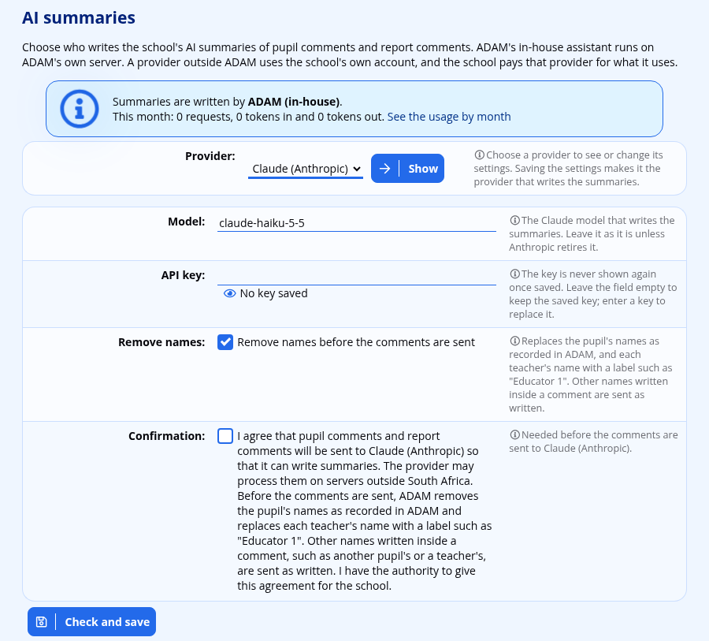

# Pupil Comments

ADAM allows for the recording of categorised incident comments on a pupil’s profile. These are not termly report comments, but rather comments that relate to specific incidences or interventions. Examples of such comments could be feedback on a behavioural incident, comments about a meeting with parents, and so on.

## Comment Categories

The categories into which the comments are placed can be managed by visiting **Administration → Pastoral Administration → Edit the comment categories**.

To edit an existing comment category, click on the **edit** option that appears to the right. **Disabled** comment categories will continue to exist (thereby preserving and captured comments), but the category will not be available for any future comments.

To add a new category, click on the button at the top of the screen.

### Adding and editing Comment Categories

When adding or editing a comment category, the following screen will appear:

The **Comment category description** is the name that the end user will see in the list of available categories and will choose from.

The option to **Email comments to parents** can be set to one of four options, the default of which is “Never”. The options are:

-   **Never**: The entered comment will never be emailed home and no option to allow them to be emailed will be given. Such comments are confidential by nature.
-   **Discouraged**: The user will be given the option to have the entered comment emailed to parents, but the default selection will be set to “No”.
-   **Encouraged**: The user will be given the option to have the entered comment emailed to parents, and the default selection will be set to “Yes”.
-   **Always**: The entered comment will always be emailed to parents and users do not have the option of changing this.

Considering that the main aim of this feature is to provide a space for confidential comments, the generally accepted practice is that such categories should either be set to “Never” or, at its most generous, “Discouraged”. This will prevent comments that are mistakenly placed in incorrect categories from being emailed to parents.

Note also that under the pending POPI legislation, parents do have the right to request all information stored about them. These comments would form part of such a POPI request and, as such, should be treated as if they are publicly visible.

In the bottom, add in any **template text** that you would like prepopulated into the comment box on the entry screen. In the image above, an outline for the minutes of a meeting with parents is shown. This could allow you to create quite specific lists and forms to complete.

Once complete, remember to **Save the comment category**.

## Entering Pupil Comments

Pupil comments can either be captured by using the option from the menu (**Pupils → Pupil Administration → Pupil’s personal comments**), from the home page (in the **Your Classes** block, click on **Pupils** next to one of your classes, and then below the pupil’s image and name, click on the **Comment** option), or from the **Pupil’s Info** page, as shown below, by clicking on the **Add a new comment** option:

The following screen is shown:

The **Category** refers to the comment categories that were [described above](#comment-categories).

The next two settings, **Visible to** and **Limit to staff groups** require some explanation because the two settings work in concert with each other to restrict who can see the pupil’s comment. Note that all the staff who can see the comment will be shown in the list below the option **Email staff**. That setting only controls whether they receive an email copy of the comment. Even if they don’t receive an emailed copy, *any listed staff member* would see the pupil’s comment appear on their profile.

The **Visible to** option provides a general idea of how sensitive the comment is in terms of who can see it. **Any staff member** would mean anyone that can log in to ADAM using the staff login page. **Staff members who teach the pupil** would include only those where the staff member has been assigned to a class with that pupil in it *in addition to* any staff members who have the permission to see sensitive comments. The last option, **Only staff members who have permissions to view sensitive comments** would only include the teachers who have those permissions.

The next option will restrict the visibility of the comment to specific permission groups. The groups listed here are ones that have been given **secondary permission status** (see [staff permission groups](security-administration-for-staff.md#managing-security-groups) for more information). On a default setup, schools would only see “All staff” listed as an option here and additional groups would need to be added.

At the option to **Email staff**, the different subject categories are shown. This allows you to quickly select all academic staff, for example.

> [!WARNING]
> Again, remember that this list shows all staff who can see the comment. Any staff who are ticked on this list will receive an additional email alert. If a staff member is listed here at all, they will be able to see your comment.

The **Email Parents** option may or may not be enabled depending on how the [comment category was set up](#comment-categories).

Below this, there is the space to enter a **comment**. If the comment category has a template assigned with it, the template text should already appear in this box.

> [!NOTE]
> As a safety precaution, once the text in the box is modified in any way, changing the category will no longer update the template. This is to prevent ADAM deleting any of your work by replacing it with a blank template.

Finally, if the user has [permissions to add documents](document-repository.md#staff-permissions) to any [document repository category](document-repository.md#categories), they will see a **Supporting Documentation** option at the bottom. Note that this only appears if it can be used.

At the bottom is a button to **Save comment** which will add the comment to a pupil’s profile.

## AI Summaries

ADAM can write a short summary of a pupil’s comments. The summary appears above the comments wherever ADAM lists them, such as on the **Comments** tab of the **Pupil’s Info** page. It is based on the pupil’s 20 most recent comments. Each time a comment is added, ADAM asks for a new summary. The summary is written in the background, so the new one appears a little later.

A note under each summary says who wrote it:

-   ADAM’s in-house assistant, in which case nothing was shared with anyone outside ADAM.
-   Claude, from Anthropic, which the school chose to use.
-   The school’s own AI server.
-   ADAM’s in-house assistant, after the school’s chosen provider could not complete the summary. The note names that provider, because the comments were sent to it first.

The AI can make mistakes. Read the comments themselves before you make an important decision.

A [sandbox site](sandbox-sites.md#ai-summaries-are-not-made) does not write new summaries.

### Who can read the summaries

Only staff with the **View AI Summary** permission see the summary. The permission is on the **Pupil Admin** tab, under the **Pastoral Comments** heading, when [changing the permissions of a group](security-administration-for-staff.md#changing-the-permissions-of-a-group).

Give this permission sparingly. The summary is based on all of the pupil’s recent comments, including sensitive ones. A staff member who cannot read some of those comments may still learn confidential information from the summary, without the context the comments would give.

### Choosing who writes the summaries

By default, ADAM’s in-house assistant writes the summaries on ADAM’s own server, and nothing leaves ADAM. A school can choose instead to use Claude, from Anthropic, or its own AI server, with its own account and key. The school pays that provider for what it uses. The same choice applies to the summaries of report comments.

To choose, go to **Administration → Site Administration → Edit site settings**, open the **Integrations** tab, and under the **AI Summaries** heading click **Choose who writes AI summaries**. This opens the **AI summaries** page. It needs the **Edit Site Settings** permission, which is on the **Site Admin** tab.

The box at the top of the page names the provider that writes the summaries now, who enabled it and when, and how many summaries were requested this month.

Choose a **Provider** and click **Show** to see its settings. The choices are **ADAM (in-house)**, **Claude (Anthropic)** and **Your own server**. Showing a provider’s settings does not change anything: the provider is used only once its settings are saved.

-   **Server address** (your own server only): the address of the school’s server, up to the version, for example https://llm.school.example/v1. When you change the address, enter the key again: ADAM does not send the saved key to a new address.
-   **Model** (Claude and your own server): the model that writes the summaries. For Claude, leave it as it is unless Anthropic retires the model.
-   **API key** (Claude and your own server): the school’s key. Once the key is saved, ADAM shows only its last few characters. Leave the field empty to keep the saved key, or enter a new key to replace it.
-   **Time limit (seconds)** (your own server only): how long ADAM waits for the server to answer one request.
-   **Maximum input (characters)** (your own server only): the longest text ADAM sends in one request. Longer comments are summarised in parts.
-   **Remove names**: ticked by default. ADAM replaces the pupil’s names as they are recorded in ADAM, and replaces each teacher’s name with a label such as “Educator 1”. Other names written inside a comment, such as another pupil’s, are sent as written.
-   **Confirmation** (Claude and your own server): the school’s agreement to send pupil comments and report comments to the provider. Read the agreement before you tick it. It names the provider, says that the provider may process the comments on servers outside South Africa, and says whether names are removed. The person who ticks it confirms that they have the authority to agree on behalf of the school. For your own server, enter the server address and click **Check and save** first, because the agreement names the server.

Click **Check and save**. ADAM first sends a test request to the provider:

-   If the test fails, nothing is saved, and the page says why.
-   If the test passes, the settings are saved, the provider writes the summaries from then on, and the page shows a sample summary that the provider wrote.

A change to the provider, the server address or **Remove names** changes the wording of the agreement, so ADAM asks for the agreement again.

### When a provider fails

If Claude or the school’s own server cannot write a summary, ADAM’s in-house assistant writes it instead. The note under that summary says so.

ADAM also emails the address in the **System Admin’s Email** site setting. The email names the provider and the kind of fault. ADAM sends it at most once a day for each kind of fault. The **AI summaries** page also shows the last failure, when it happened and why, until a later request to the provider succeeds.

### Reading the usage figures {#usage}

On the **AI summaries** page, click **See the usage by month** to open the **AI summary usage** page. It has one row for each month, provider and model, for the last twelve months:

-   **Month**: the month in which the summaries were requested.
-   **Provider** and **Model**: who was asked to write the summaries.
-   **Requests**: the number of summaries requested.
-   **Tokens in** and **Tokens out**: what the provider counted for the requests and answers. The provider bills by these counts. ADAM’s in-house assistant does not count tokens, so its rows show zero.
-   **Fallbacks**: requests that the chosen provider could not answer, which ADAM’s in-house assistant answered instead.
-   **Failures**: requests that ADAM’s in-house assistant could not answer either. ADAM asks for these summaries again later.
