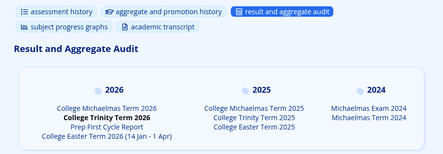
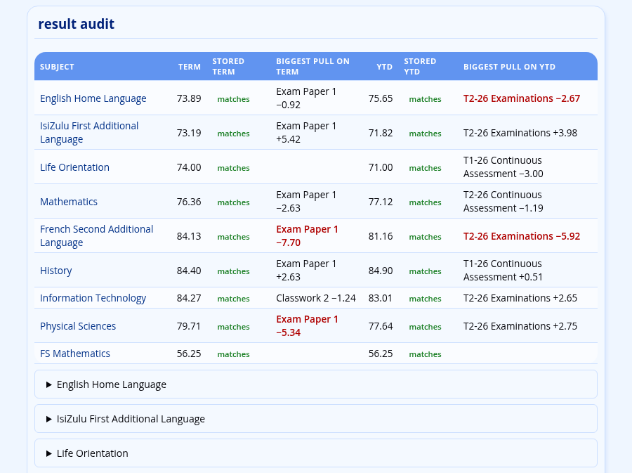
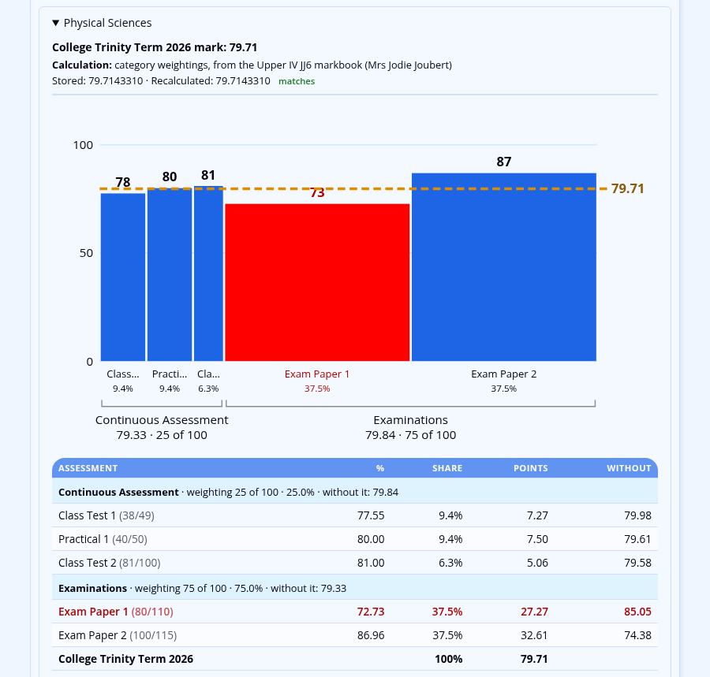
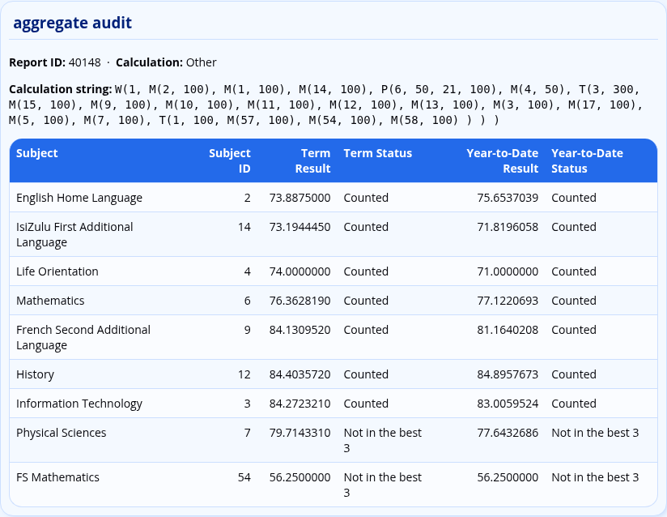
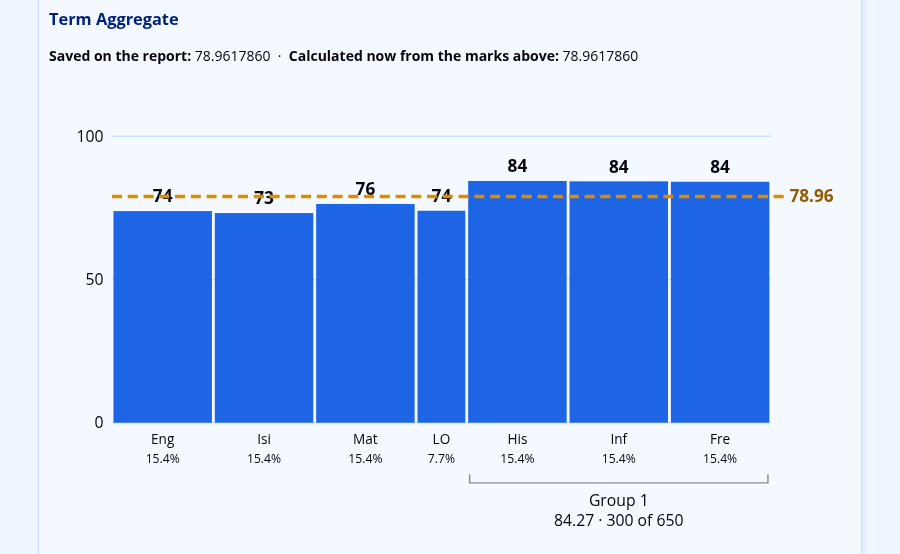

# Result and Aggregate Audit

The result and aggregate audit explains how ADAM calculated a pupil’s marks for one reporting period. It shows how each subject’s term mark and year-to-date mark were worked out, and how the pupil’s term and year-to-date aggregates were worked out. Use it to answer a parent’s query about a mark without recalculating the mark by hand.

The audit only explains marks. It does not change any mark, and nothing on the page can be edited. To see *who* entered or changed an assessment mark, use the [mark change history](change-history-reports.md#assessment-mark-change-history) instead.

## Opening the Audit

Open the pupil’s profile (**Pupils → Pupil Administration → Pupil Info**) and click **academic records**. Under **Academic Progress**, click **result and aggregate audit**.

Every academic records page opens with the same menu of pages, and the page you are on is highlighted:

Use this menu to move from one page to the next without going back to the academic records overview. The menu keeps the reporting period you are looking at. If you are looking at a term on the **assessment history** page, the audit opens on the same term. If the next page has nothing for that term, it opens on its latest reporting period instead.

Below the heading, the reporting periods that have something to audit are listed by year. The period on view is in bold. Click another period to audit that one instead. For a pupil with no assessment results and no reports, the page says *“No academic records exist.”*

> [!NOTE]
> The audit is available to any staff member who can see the pupil’s academic records: those with **View pupils’ academic records**, those with **View pupils’ academic records (teacher)** for the pupils they teach, and those with **View pupils’ academic records (default teacher)** for the pupils they teach in the default subject. It needs no further permission. In the menu, **subject progress graphs** appears only to staff with **View a Subject Progress Graph for a pupil**, and **academic transcript** only to staff with **View academic transcripts**. Parents and pupils cannot see these pages.

The same menu can also be placed on the pupil’s profile overview with the **Academic Progress Menu** widget (see [Profile Overview Layouts](profile-overview-customisation.md#editing-the-blocks)). That widget is shown only to staff who also have **View a Subject Progress Graph for a pupil**.

The audit used to be split over two pages. The result audit sat behind a **show result audit** link at the foot of the **assessment history** page, and the aggregate audit sat at the foot of the **aggregate and promotion history** page. Both are now on this page only.

## Result Audit

The **Result Audit** explains each subject’s term mark and year-to-date mark. It begins with a summary table, with one row for each subject the pupil takes in the reporting period:

| Column | Meaning |
| ------ | ------- |
| **Subject** | The subject. Click it to open the subject’s detail. |
| **Term** | The term mark as ADAM calculates it now. |
| **Stored term** | **matches** when the term mark saved for the pupil is the same as the mark calculated now. When the two differ, the saved mark is shown in red, for example “stored 62.10”. **No stored mark** means that no term mark is saved for the pupil. |
| **Biggest pull on term** | The assessment whose removal would change the term mark the most, and by how much. “Exam Paper 1 −5.34” means that the term mark is 5.34 marks lower than it would be without Exam Paper 1. |
| **YTD** | The year-to-date mark as ADAM calculates it now. |
| **Stored YTD** | As **Stored term**, for the year-to-date mark. |
| **Biggest pull on YTD** | As **Biggest pull on term**, for the year-to-date mark. Each input is led by the shortened name of its reporting period, such as “T2-26 Examinations”. **term mark only** means that no year-to-date calculation is set, so the year-to-date mark is a copy of the term mark. |

A pull shown in red is pulling the mark **down** by 5 marks or more. Red points you to the input to look at first. It is not a sign that a mark is wrong.

> [!TIP]
> The shortened name of each reporting period comes from the [reporting period settings](reporting-period-administration.md). A period without a shortened name is shown by its full name.

### A subject’s detail

Below the summary, each subject is listed as a row that can be opened. Click a subject’s row, or the subject’s name in the summary, to open its detail. A row whose saved mark differs from the mark calculated now says so, for example “stored 62.10 · recalculated 59.38”.

The detail explains the term mark first and the year-to-date mark second. On a wide screen the two sit side by side. Each has the same parts:

1. **The heading**, with the mark: for example “College Trinity Term 2026 mark: 79.71” or “Year-to-date mark: 77.64”.
2. **The calculation**: what produced the mark, and where it is set. A term mark is usually worked out from the category weightings in the class’s mark book, and the line names the class and its teacher. If the class has a [term calculation](mark-book-administration.md#when-the-term-mark-is-set-by-a-calculation), the line names that calculation instead. A year-to-date mark names its aggregated result calculation and its inputs, and says whether the calculation was set in the class’s mark book or in the grade’s [reporting period settings](aggregated-results.md#using-an-aggregated-result-calculation-as-a-year-to-date-result).
3. **Stored and recalculated**: the mark saved for the pupil and the mark calculated now, both to seven decimal places, with **matches** or **does not match**. Marks are saved to seven decimal places, so this shows whether a mark that looks like 74.5 is really 74.4999999.
4. **A reason**, when one overrides the calculation:
    - *“Entered by hand on the report”*: the mark was typed in on the reporting screen, so ADAM did not calculate it. ADAM’s own calculation still follows, for comparison. See [cancelling an override](report-comments.md#my-marks-on-the-reporting-screen-are-wrong-and-wont-update).
    - *“No YTD calculation is set for this class or grade, so the YTD mark is the term mark.”* No chart is drawn for the year-to-date mark.
    - *“Absent: this grade requires every category to have a mark, and …”*: the grade requires a mark in every assessment category, and the category named has none.
5. **The chart** (described below).
6. **The table** (described below).

#### The chart

Each column in the chart is one input to the mark. For a term mark, the inputs are usually assessments. For a year-to-date mark, they are an assessment category in a term, a whole term, or an assessment, depending on the year-to-date calculation.

- A column’s **width** is the input’s share of the mark. The widths add up to 100%.
- A column’s **height** is the input’s percentage. The percentage is written above the column, and the input’s name and share below it. When a column is too narrow for its name, the name is shortened and ends in “…”, for example “Practi…”. When the column is too narrow for its share or its percentage as well, those are left out.
- The **dashed line** marks the final mark.
- The **brackets** below the columns group them, for example by assessment category. Each bracket’s caption has two lines: its name, then its mark and its weighting, for example “Continuous Assessment” above “79.33 · 25 of 100”. A caption that would run into the caption beside it moves down to a second row. When there is still no room, only the bracket’s name is shown, or no caption at all.
- An input that was absent, or that was not counted (for example by a “best of” rule), has no share, so it is left out of the chart. The table still lists it.

Hover over a column to see the input’s full name, its percentage and its share of the mark. Hover over a bracket to see its whole caption. The table below the chart also gives every name in full.

A wide column that sits far below the dashed line is pulling the mark down. A column shown in red meets the warning rule below.

#### The table

The table lists the same inputs as the chart, grouped under a row for each bracket.

| Column | Meaning |
| ------ | ------- |
| **Assessment** or **Input** | The input’s name. An assessment shows the pupil’s raw score beside it, for example “(80/110)”. |
| **%** | The input’s percentage, or **Absent**. |
| **Share** | The input’s share of the final mark. |
| **Points** | The percentage multiplied by the share. The points add up to the final mark. |
| **Without** | What the final mark would be if this input were left out. A dash means that the input was not counted, so leaving it out changes nothing. |

Each bracket’s row gives its weighting (for example “weighting 75 of 100”), its share, and the mark without it. The last row gives the final mark.

A bracket that the calculation gives no weight starts hidden in the table, together with its inputs. It has no width in the chart either, so it does not show there. A year-to-date mark often has several such brackets: a reporting period with no category weightings in the year-to-date calculation counts for nothing. To show them, tick the box under the table. It counts the hidden brackets, for example **Show the 7 sections weighted zero**, or reads **Show the section weighted zero** when there is only one. When every bracket is weighted zero, none is hidden.

A row is red when leaving it out would **raise** the mark by 5 marks or more. An assessment is also red when it sits inside a red bracket and is below the final mark. A category is often split over several assessments, and none of them may move the mark much on its own while the category as a whole does.

Two notes may appear under the table:

- *“This grade requires every category to have a mark. ‘Without’ figures ignore that rule.”* The **Without** column answers “what if this input did not exist?”, not “what would ADAM print?”.
- *“This breakdown does not reproduce ADAM’s mark exactly, so some figures may be incomplete.”* The chart and table do not add up to the recalculated mark, beyond the small differences that rounding causes. Rely on the stored and recalculated marks at the top, and treat the chart and table as a guide.

## Aggregate Audit

The **Aggregate Audit** explains the pupil’s term and year-to-date aggregates. If the pupil has no report for the period, it says *“The pupil has no report for this reporting period, so there is no aggregate to audit.”* In the same way, if the pupil has no subjects in the period, the **Result Audit** says *“The pupil has no subjects in this reporting period, so there are no results to audit.”*

The section opens with the **Report ID** and the **Calculation**: the [aggregate calculation](aggregate-calculations.md#calculation-methods) set for the pupil’s grade in this reporting period. If none is set, it reads **None set for this grade and period**. A custom calculation also shows its **Calculation string**.

The table lists each of the pupil’s subjects on the report:

| Column | Meaning |
| ------ | ------- |
| **Subject** and **Subject ID** | The subject. The ID is the number a custom calculation string uses for the subject. |
| **Included** | Whether the subject is set to count towards the aggregate in its [subject settings](subjects.md#editing-a-subject). |
| **Compulsory** | Whether the subject is set as compulsory in the aggregate. |
| **Weighting** | The subject’s aggregate weighting. |
| **Term Result** and **Year-to-Date Result** | The subject’s marks on the report, to seven decimal places. |
| **Term Status** and **Year-to-Date Status** | What the calculation did with the subject’s mark. |

**Included**, **Compulsory** and **Weighting** are left out when the calculation is a custom calculation string, because a custom calculation ignores those subject settings.

The status explains each subject:

- **Counted**: the mark was used. **Counted as …** means that a different mark was used, and gives it.
- **Not in the best 3** (or another number), **Not in the first 3** or **No places left**: the calculation takes only some subjects, and this one was not among them.
- **Not included in the aggregate** or **Weighting is 0**: the subject’s settings keep it out of the aggregate.
- **Not used by this calculation** or **Not part of the calculation**: the calculation does not use the subject.
- **Absent**: the pupil has no mark for the subject.

### Term Aggregate and Year-to-Date Aggregate

Below the table, the term aggregate and the year-to-date aggregate each have their own part, headed **Term Aggregate** and **Year-to-Date Aggregate**.

Each part starts with the aggregate **Saved on the report** beside the aggregate **Calculated now from the marks above**. If the two differ, ADAM warns: *“These differ: the marks or the aggregate settings have changed since the aggregate was saved.”*

A chart follows, drawn in the same way as the result audit’s chart: each subject is a column whose width is its share of the aggregate and whose height is its mark.

Below the chart, one table explains each step of the calculation, starting with the innermost group of subjects and ending with the aggregate itself. Each table is headed with the group and the rule it uses, for example “Group 1: best 3 by mark” or “Aggregate: weighted average”. It lists each subject’s **Mark**, **Weighting**, **Mark × weighting** and **Status**. The **Total of the counted marks** row adds up the counted subjects, and the **Result** row divides that total by the total weighting. A group inside another group appears in its parent’s table as one row, which links to the group’s own table.

## When a Saved Mark Does Not Match

A saved mark and a recalculated mark usually differ because something changed after the mark was saved: an assessment mark, a weighting, a calculation, or a subject’s aggregate settings.

- To save the subject marks again, use **Reporting → Promotion Results → Recalculate Marks and Symbols**. See [Mark Book Results Recalculation](mark-book-administration.md#mark-book-results-recalculation).
- To save the aggregates and promotion decisions again, use **Reporting → Promotion Results → Recalculate Aggregate and Promotions**. See [Recalculating promotion decisions](promotion-requirements.md#recalculating-promotion-decisions).

A mark entered by hand on the report is not recalculated until the override is cancelled.
