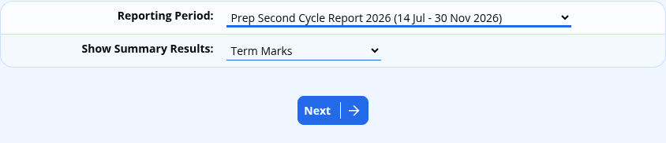

# Results Analysis

The **Results Analysis** heading, on both the **Assessment** tab and the **Reporting** tab, lists reports that look at the results of a whole grade or of the whole school. Parents and pupils cannot see these reports. This page describes **View subject averages**. The other reports under the heading are not yet described in this manual.

## Subject Averages

**View subject averages** shows how each grade performed in each academic subject for one reporting period. It is a single table, with the subjects down the side and the grades across the top. Each cell holds the average mark of the pupils in that grade for that subject.

### Opening the report

The report appears in two places in the menu. Both lead to the same page:

-   **Assessment → Results Analysis → View subject averages**
-   **Reporting → Results Analysis → View subject averages**

The page is titled **School Subject Averages**. It needs the **View mark review sheet** permission, which is on the **Reporting Admin** tab under the **Results Review** heading when [changing the permissions of a group](security-administration-for-staff.md#changing-the-permissions-of-a-group).

### Choosing what to average

The page opens with a short form:

-   **Reporting Period**: the reporting period to look at. Every reporting period is listed, grouped by year, with the latest first.
-   **Show Summary Results**: the result that is averaged.
    -   **Term Marks**: the term mark on each pupil’s report for the reporting period.
    -   **Year to Date Marks**: the year-to-date mark on each pupil’s report for the reporting period.
    -   Under **Assessment Category**, one choice for each assessment category: each pupil’s result in that category, worked out from the pupil’s marks in the category’s assessments for the reporting period. Each assessment counts in proportion to its **Adjusted (Weighted) Total** (see [Weighting Assessments and Assessment Categories](mark-book-administration.md#weighting-assessments-and-assessment-categories)). Only assessments of the type “Marks and Comments” count. Only the assessment categories that exist now are listed, so a category that was used in an earlier year and has since been removed cannot be chosen.

Click **Next** to show the table.

### Reading the table

The heading above the table names the result and the reporting period, for example “Term Marks for Term 2 2026”. The table has one row for each subject and one column for each grade:

-   The **rows** are the subjects in the school’s academic subject category that had pupils enrolled on the last day of the reporting period. Subjects in other categories, such as sport or cultural activities, are not listed. The academic subject category is the **Academic Subject Category** site setting (see [Changing Site Settings](changing-site-settings.md)).
-   The **columns** run from the school’s **Starting Grade** to its **Finishing Grade**, both of which are site settings.
-   Each **cell** is the average, as a percentage to two decimal places, of the marks of the pupils in that grade for that subject.

For term marks and year-to-date marks, a pupil counts towards a grade’s average if they were in a class of that subject and grade on the last day of the reporting period, and their report has a mark for the subject. A pupil without a mark is left out, so a missing mark does not count as zero. The averages use the marks as they are now, whether or not the reports have been published.

For an assessment category, ADAM first works out each pupil’s result in the category, from the category’s assessments set for classes of that subject and grade. The cell is the average of those results. A pupil who was absent from an assessment is not counted for that assessment.

A cell is blank when no pupil in the grade has a mark of that kind for the subject. This happens when the grade does not take the subject, when the marks have not been entered yet, or, for an assessment category, when the grade had no assessments in that category during the reporting period.

The table always covers every grade and every subject enrolled in the school, even when the reporting period is used by only part of the school, such as a preparatory school. Grades and subjects outside that part are blank, so a long table can have many empty rows and columns. Scroll across and down to find the grades you are looking for.
