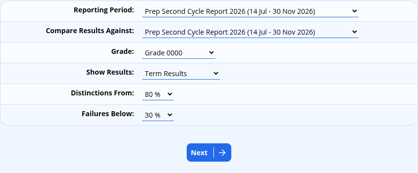
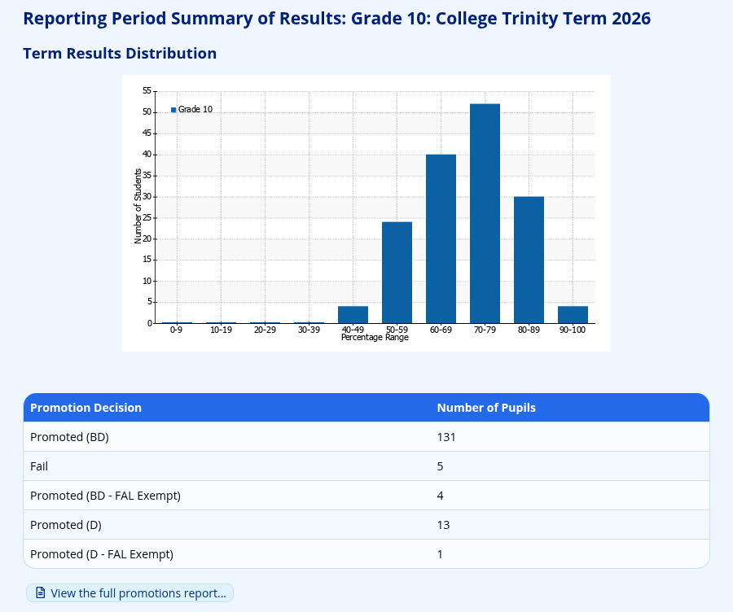
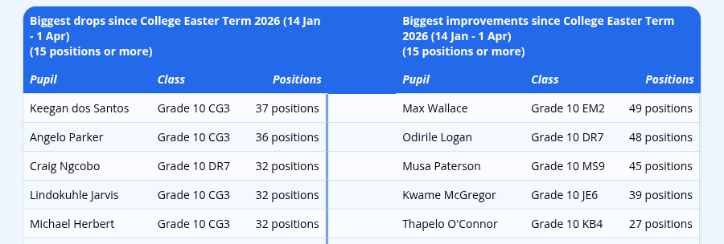

# Results Analysis

The **Results Analysis** heading, on both the **Assessment** tab and the **Reporting** tab, lists reports that look at the results of a whole grade or of the whole school. Parents and pupils cannot see these reports. This page describes **View subject averages** and **View results summary (by grade)**. The other reports under the heading are not yet described in this manual.

## Subject Averages

**View subject averages** shows how each grade performed in each academic subject for one reporting period. It is a single table, with the subjects down the side and the grades across the top. Each cell holds the average mark of the pupils in that grade for that subject.

### Opening the report

The report appears in two places in the menu. Both lead to the same page:

-   **Assessment → Results Analysis → View subject averages**
-   **Reporting → Results Analysis → View subject averages**

The page is titled **School Subject Averages**. It needs the **View mark review sheet** permission, which is on the **Reporting Admin** tab under the **Results Review** heading when [changing the permissions of a group](security-administration-for-staff.md#changing-the-permissions-of-a-group).

### Choosing what to average

The page opens with a short form:

-   **Reporting Period**: the reporting period to look at. Every reporting period is listed, grouped by year, with the latest first.
-   **Show Summary Results**: the result that is averaged.
    -   **Term Marks**: the term mark on each pupil’s report for the reporting period.
    -   **Year to Date Marks**: the year-to-date mark on each pupil’s report for the reporting period.
    -   Under **Assessment Category**, one choice for each assessment category: each pupil’s result in that category, worked out from the pupil’s marks in the category’s assessments for the reporting period. Each assessment counts in proportion to its **Adjusted (Weighted) Total** (see [Weighting Assessments and Assessment Categories](mark-book-administration.md#weighting-assessments-and-assessment-categories)). Only assessments of the type “Marks and Comments” count. Only the assessment categories that exist now are listed, so a category that was used in an earlier year and has since been removed cannot be chosen.

Click **Next** to show the table.

### Reading the table

The heading above the table names the result and the reporting period, for example “Term Marks for Term 2 2026”. The table has one row for each subject and one column for each grade:

-   The **rows** are the subjects in the school’s academic subject category that had pupils enrolled on the last day of the reporting period. Subjects in other categories, such as sport or cultural activities, are not listed. The academic subject category is the **Academic Subject Category** site setting (see [Changing Site Settings](changing-site-settings.md)).
-   The **columns** run from the school’s **Starting Grade** to its **Finishing Grade**, both of which are site settings.
-   Each **cell** is the average, as a percentage to two decimal places, of the marks of the pupils in that grade for that subject.

For term marks and year-to-date marks, a pupil counts towards a grade’s average if they were in a class of that subject and grade on the last day of the reporting period, and their report has a mark for the subject. A pupil without a mark is left out, so a missing mark does not count as zero. The averages use the marks as they are now, whether or not the reports have been published.

For an assessment category, ADAM first works out each pupil’s result in the category, from the category’s assessments set for classes of that subject and grade. The cell is the average of those results. A pupil who was absent from an assessment is not counted for that assessment.

A cell is blank when no pupil in the grade has a mark of that kind for the subject. This happens when the grade does not take the subject, when the marks have not been entered yet, or, for an assessment category, when the grade had no assessments in that category during the reporting period.

The table always covers every grade and every subject enrolled in the school, even when the reporting period is used by only part of the school, such as a preparatory school. Grades and subjects outside that part are blank, so a long table can have many empty rows and columns. Scroll across and down to find the grades you are looking for.

## Results Summary by Grade

**View results summary (by grade)** gives a one-page picture of how a grade did in a reporting period. It shows how the grade’s results are spread, how many pupils received each promotion decision, which pupils moved furthest up or down the grade since an earlier period, and which pupils failed or achieved a distinction.

### Opening the results summary

Go to **Reporting → Results Analysis → View results summary (by grade)**. The report is not on the **Assessment** tab.

The page is titled **Reporting Period Summary of Results**. It needs the **View mark review sheet** permission, which is on the **Reporting Admin** tab under the **Results Review** heading when [changing the permissions of a group](security-administration-for-staff.md#changing-the-permissions-of-a-group).

### Choosing the grade and the periods

The page opens with a short form:

-   **Reporting Period**: the reporting period to summarise. ADAM selects a reporting period that is under way today, if there is one.
-   **Compare Results Against**: an earlier reporting period. The summary lists the pupils whose position in the grade changed most between this period and the **Reporting Period**. ADAM selects the second period in the list. That is not always the period before the one you are summarising, and it can be the same period, as in the picture above. Check this choice before you continue.
-   **Grade**: the grade the pupils were in during the **Reporting Period**. Every grade from the school’s **Starting Grade** to its **Finishing Grade** is listed.
-   **Show Results**: the result that the whole summary uses.
    -   **Term Results**: each pupil’s term aggregate and term promotion decision.
    -   **Year-to-Date Results**: each pupil’s year-to-date aggregate and year-to-date promotion decision.
-   **Distinctions From**: the lowest result that counts as a distinction. The default is 80 %.
-   **Failures Below**: results below this percentage count as failures. The default is 30 %.

Click **Next**. The summary opens in a new tab or window, so the form stays open for another grade.

### Reading the summary

The heading names the grade and the reporting period, for example “Reporting Period Summary of Results: Grade 10: College Trinity Term 2026”. The summary counts the pupils who were in the grade on the last day of the reporting period and who have an aggregate for that period. A pupil without an aggregate is left out of every part of the summary. The summary uses the results as they are now, whether or not the reports have been published.

#### Results distribution

The graph, headed **Term Results Distribution** or **Year-to-Date Results Distribution**, shows the number of pupils whose aggregate falls in each band of ten percentage points, from “0-9” to “90-100”. ADAM rounds each aggregate to a whole number before placing it in a band.

#### Promotion decisions

The table below the graph lists each promotion decision given in the grade, with the **Number of Pupils** who received it. For **Term Results** it counts the term promotion decisions, and for **Year-to-Date Results** the year-to-date ones. To see how ADAM reaches these decisions, read [Promotion Requirements](promotion-requirements.md#interpreting-adams-promotion-decisions).

**View the full promotions report...** opens the **Promotion Decisions Report** for the same grade and reporting period, which lists each pupil’s aggregates and promotion decisions. That report also needs the **View promotion results** permission, which is on the **Academic Admin** tab.

#### Biggest drops and improvements

The next table compares each pupil’s position in the grade with their position in the **Compare Results Against** period:

ADAM ranks the pupils in the grade by aggregate in each period. Pupils with the same aggregate share a position. The comparison follows the same pupils: when the comparison period is in an earlier year, ADAM ranks them within the grade they were in that year. Only pupils who have an aggregate in both periods are compared.

A pupil is listed when their position changed by at least a tenth of the number of pupils compared, rounded to the nearest whole number, and never less than one position. With 150 pupils compared, a pupil must move 15 positions or more. The column headings show the number, for example “(15 positions or more)”.

-   **Biggest drops since** the comparison period, on the left, lists the pupils who moved down, the biggest drop first.
-   **Biggest improvements since** the comparison period, on the right, lists the pupils who moved up, the biggest improvement first.

Each row shows the **Pupil**, their **Class** in the reporting period, and the number of **Positions** they moved. The class is the pupil’s class in the school’s default class subject, usually a register or form class.

ADAM shows this table only when at least two pupils dropped, or at least two pupils improved, by that many positions.

#### Failures and distinctions

The last table lists, on the left, the pupils whose result is below the **Failures Below** percentage, the lowest result first. On the right, it lists the pupils whose result is at or above the **Distinctions From** percentage, the highest result first. Each row shows the **Pupil**, their **Class**, and their **Result** to two decimal places.

ADAM rounds each result to a whole number before comparing it with the two percentages. With the defaults, a result of 29.50% is not a failure, because it rounds to 30%, and a result of 79.50% is a distinction, because it rounds to 80%.

The line at the bottom of the summary gives the date and time at which it was produced.
