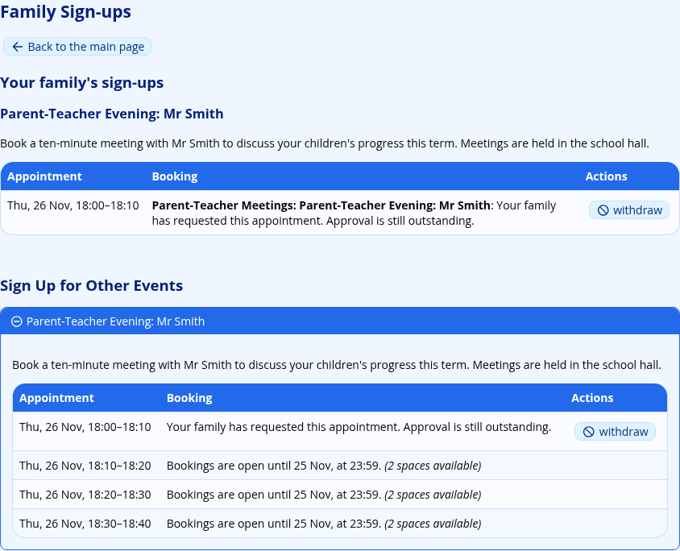

# Sign-ups: A Guide for Parents and Pupils

**Your school may use ADAM to let you book appointments and sign up for activities, such as a meeting with a teacher at a parent-teacher evening, a sports team or an extra lesson. This guide explains how to find the sign-ups on the portal, how to book, and how to cancel.**

There are several sections in this guide. The following links will jump you to the one you need:

1.  [Two kinds of sign-up](#two-kinds-of-sign-up)
2.  [For parents: booking for your family](#for-parents-booking-for-your-family)
3.  [For parents: signing your child up](#for-parents-signing-your-child-up)
4.  [For pupils: signing yourself up](#for-pupils-signing-yourself-up)
5.  [What the Booking column tells you](#what-the-booking-column-tells-you)
6.  [Help! I can’t see the sign-ups option!](#help-i-cant-see-the-sign-ups-option)
7.  [Help! The appointment is full!](#help-the-appointment-is-full)
8.  [Help! Bookings have closed!](#help-bookings-have-closed)

## Two Kinds of Sign-up

The school sets up each event in one of two ways:

-   **A family event** is booked by parents for the family as a whole. A parent-teacher evening is the usual example: you book a meeting with a teacher, and the meeting is about your children. You book these under **Family sign-ups**.
-   **A pupil event** is booked for one pupil. Clubs, sports teams, extra lessons and outings are usually pupil events. Pupils book these for themselves under **View sign-ups**. Parents can also book them for a child, from that child’s card.

Each event has one or more **appointments**. An appointment might be a five-minute slot with a teacher, a date, or a season. You always sign up for an appointment, not for the whole event.

## For Parents: Booking for Your Family

### Finding Family Sign-ups

Log in to the family portal. See [Logging on to ADAM: A Guide for Parents](logging-on-to-adam-a-guide-for-parents.md#logging-on-to-adam-a-guide-for-parents) if you have not logged in before.

Under the **Family** heading, click **Family sign-ups** (**Family Portal → Family → Family sign-ups**). The **Family Sign-ups** page opens.

### What the Family Sign-ups Page Shows

The page has two lists:

-   **Your family’s sign-ups** lists the appointments your family has booked, including those that happened in the last few weeks. If you have not booked anything, it says “No appointments found.”
-   **Sign Up for Other Events** lists the family events that your family may book and whose bookings have not yet closed. Each event has its own bar. Click the bar to open it and see the event’s information and its appointments.

Each list is a table with three columns: **Appointment** (the date, time or name of the slot), **Booking** (whether you can book it, and whether you have) and **Actions** (the links you can click). See [What the Booking column tells you](#what-the-booking-column-tells-you).

An event may be open only to families with a child in certain classes. If none of your children is in those classes, the event does not appear on your list.

### Booking an Appointment

1.  Under **Sign Up for Other Events**, click the event’s bar to open it.
2.  Find the appointment you want and click **sign up** in the **Actions** column.
3.  ADAM shows the message “Your family is booked for this appointment.” and the appointment appears under **Your family’s sign-ups**.

You do not choose a child when you book. The booking is for your family, and the school can see which of your children it concerns.

> [!NOTE]
> If your children’s parents are separated and each parent has their own family login, each family books separately. One parent cannot see, cancel or be reminded of a booking that the other parent made.

### How Many Appointments Your Family May Book

The school can limit how many appointments one family may book for an event. Once you reach the limit, the **sign up** links for that event’s other appointments disappear. If you click a **sign up** link that was on the page before you reached the limit, ADAM shows the message “Your family has already booked the maximum number of appointments for this event.” If you cancel one of your bookings, you can book another. Only appointments that have not yet taken place count towards the limit.

### Approval of Family Bookings

Some events need the organising teacher to approve each booking. When you book one of these, ADAM still shows “Your family is booked for this appointment.”, but the **Booking** column reads “Your family has requested this appointment. Approval is still outstanding.” Your request holds the place while you wait.

You will know the outcome in two ways:

-   You receive an email telling you that the booking was approved or not approved.
-   Once the teacher approves it, the **Booking** column reads “Your family is attending this appointment.” If the teacher does not approve it, the appointment disappears from **Your family’s sign-ups**.

### Cancelling or Changing a Booking

To cancel a booking, find it under **Your family’s sign-ups** and click **cancel**. If the booking is still waiting for approval, the link reads **withdraw** instead. ADAM shows the message “Your family’s booking has been cancelled.”

You can cancel only while bookings for that appointment are still open. After bookings close, the **cancel** link disappears. If you click **withdraw** after bookings have closed, ADAM shows the message “Bookings for this appointment are closed, so it can no longer be cancelled online.” Contact the school or the teacher instead.

There is no way to move a booking to a different appointment. Book the new appointment and then cancel the old one. If the event’s limit stops you booking the new one first, cancel the old one first, but be aware that someone else may book the place you gave up.

### Emails Your Family Receives

ADAM emails your family:

-   when the teacher approves your booking, or does not approve it;
-   when the school removes your booking;
-   when the school cancels the appointment or the whole event;
-   before the appointment, if your school sends reminders.

ADAM does not email you when you make a booking that needs no approval. The message on the screen and the entry under **Your family’s sign-ups** are your confirmation.

These emails go only to the family that made the booking.

## For Parents: Signing Your Child Up

If your school allows it, you can also sign a child up for a pupil event, such as a club or a sports team.

On your child’s card on the family portal, under the **General** heading, click **View sign-ups**. The **Sign ups** page opens. It is the same page that your child sees, and it works in the same way. Follow the steps in [For pupils: signing yourself up](#for-pupils-signing-yourself-up), starting at [What the Sign ups page shows](#what-the-sign-ups-page-shows).

Some things to be aware of:

-   The booking is your child’s. If your child logs in to ADAM, they see it too, and they can cancel it while bookings are open.
-   The page speaks as though you are the pupil. For example, it says “You are attending this appointment.”
-   Emails about approval and removal are sent to your child’s email address, not to you. Your school decides whether reminders go to the pupil, to the family, or to both.

## For Pupils: Signing Yourself Up

### Finding Your Sign-ups

Log in to the pupil portal with **Pupil Login**. On your card, under the **General** heading, click **View sign-ups**. The **Sign ups** page opens.

### What the Sign Ups Page Shows

The page has two lists:

-   **Signed Up Events for** your name lists the appointments you have signed up for, including those that happened in the last few weeks. If you have not signed up for anything, it says “No appointments found.”
-   **Sign Up for Other Events** lists the events that you may sign up for and whose bookings have not yet closed. Each event has its own bar. Click the bar to open it and see the event’s information and its appointments.

Each list is a table with three columns: **Appointment**, **Booking** and **Actions**. See [What the Booking column tells you](#what-the-booking-column-tells-you).

An event may be open only to pupils in certain classes. If you are not in one of those classes, the event does not appear on your list.

### Signing Up

1.  Under **Sign Up for Other Events**, click the event’s bar to open it.
2.  Find the appointment you want and click **sign up** in the **Actions** column.
3.  The page reloads. Check that the appointment now appears under **Signed Up Events for** your name. If someone else took the last place just before you clicked, ADAM does not book you, and the **Booking** column reads “Bookings are closed: this appointment has been filled.”

### How Many Appointments You May Book

The school can limit how many appointments each pupil may sign up for in an event. Once you reach the limit, the **sign up** links for that event’s other appointments disappear. If you cancel one of your appointments, you can sign up for another. Only appointments that have not yet taken place count towards the limit.

### Approval of Your Sign-up

Some events need a teacher to approve each sign-up. This may be the teacher who organises the event or one of your own teachers, such as your Home Room teacher. After you sign up, the **Booking** column reads “You have requested to attend this appointment. Approval is still outstanding.” Your request holds the place while you wait.

When the teacher approves your sign-up, the **Booking** column reads “You are attending this appointment.” and you receive an email whose subject begins “Appointment Approved”. If the teacher does not approve it, the appointment disappears from your list and you receive an email whose subject begins “Appointment NOT Approved”. If you want the teacher to reconsider, you must sign up again.

### Cancelling or Changing a Sign-up

To cancel, find the appointment under **Signed Up Events for** your name and click **cancel**. If the sign-up is still waiting for approval, the link reads **withdraw** instead. ADAM shows the message “You have cancelled your attendance at this appointment.”

You can cancel only while bookings for that appointment are still open. After bookings close, the **cancel** link disappears. If you click **withdraw** after bookings have closed, ADAM shows the message “Unable to cancel the appointment - bookings have already closed.” Speak to the teacher who organises the event instead.

There is no way to move a sign-up to a different appointment. Sign up for the new appointment and then cancel the old one. If the event’s limit stops you signing up for the new one first, cancel the old one first, but be aware that someone else may take the place you gave up.

### Emails You Receive

ADAM emails you:

-   when a teacher approves your sign-up, or does not approve it;
-   when a teacher removes you from an appointment (the subject begins “Appointment Sign-up Removed”);
-   when the school cancels the appointment;
-   before the appointment, if your school sends reminders.

ADAM does not email you when you sign up for an appointment that needs no approval.

## What the Booking Column Tells You

The **Booking** column shows one of these messages for each appointment:

| Message | What it means |
| --- | --- |
| “Bookings are open until …” | You can book now. If the appointment has a limited number of places, the number still free is shown in brackets, for example “(3 spaces available)”. |
| “Bookings will open on …” | You cannot book yet. The message says when bookings open and for how long. |
| “Bookings closed at …” | Bookings have closed. You can no longer book or cancel online. |
| “Bookings are closed: this appointment has been filled.” | Every place has been taken. |
| “You have requested to attend this appointment. Approval is still outstanding.” | You have signed up, and a teacher has not yet approved it. On **Family sign-ups**, this reads “Your family has requested this appointment. Approval is still outstanding.” |
| “You are attending this appointment.” | You are booked. This appears after the booking dates. On **Family sign-ups**, this reads “Your family is attending this appointment.” |

## Help! I Can’t See the Sign-ups Option!

The sign-ups options appear only if your school has turned them on for your login:

-   **Family sign-ups** appears under the **Family** heading only when a parent logs in. Pupils never see it.
-   **View sign-ups** appears under the **General** heading on each child’s card (or on your own card, if you are a pupil).

The school decides which families and pupils can see each option. If an option is missing and you expect to see it, contact the school.

If the option is there but the event you are looking for is not, the event may be open only to certain classes, or its bookings may already have closed. Contact the teacher who organises the event.

## Help! The Appointment Is Full!

When every place on an appointment has been taken, the **Booking** column reads “Bookings are closed: this appointment has been filled.” and there is no **sign up** link.

If the last place was taken just before you clicked **sign up**, the family portal shows the message “This appointment is full.”, and the pupil portal books nothing.

Choose another appointment for the same event if there is one. A place becomes free if someone cancels, so you can check again later while bookings are still open. If you need that appointment, contact the teacher who organises the event.

## Help! Bookings Have Closed!

Each appointment has a booking period set by the school. Outside that period there is no **sign up** link:

-   Before the period starts, the **Booking** column reads “Bookings will open on …”. Come back when bookings open.
-   After the period ends, the **Booking** column reads “Bookings closed at …”. You can no longer book or cancel that appointment online.

If you need to book, cancel or change an appointment after bookings have closed, contact the school or the teacher who organises the event. Staff can still make changes for you.
