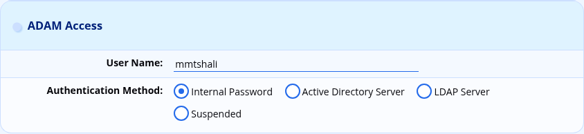

# Staff Logins and Passwords { #staff-passwords }

This page explains how a staff member logs in to ADAM, where their login name is kept, and how to set up, reset and change staff passwords.

Staff can also enrol a [passkey](passkey-authentication.md#passkey-authentication) on each of their devices, which lets them sign in with a fingerprint or face scan rather than a password. Schools can also let staff [sign in with Google or Microsoft](configuring-logins.md#google-sign-in-for-staff-and-pupils). This page covers logins with a login name and a password.

## What a staff member needs to log in

A staff member can log in with a login name and password when all four of these are true:

1.  Their staff record has a **User Name**. This is the login name that they type on the **Staff Login** page.
2.  Their **Authentication Method** is set to the method your school uses, and not to **Suspended**.
3.  They have a password. For **Internal Password**, ADAM stores the password and you set it in ADAM. For **Active Directory Server** or **LDAP Server**, the password is the staff member’s network password, and ADAM never stores it.
4.  They have a current employment contract. A staff member whose contract has not started yet, or has ended, cannot log in. See [Viewing a staff member’s employment history](staff-information.md#viewing-a-staff-members-employment-history).

The **User Name** and **Authentication Method** are in the **ADAM Access** section of the staff member’s details.

## Finding a staff member’s login name

To see or change a staff member’s login name:

1.  Click on the **Staff** tab and, under the **Staff Administration** heading, click on **Edit a staff member’s information**.
2.  Choose the staff member and click on **Next**.
3.  Scroll down to the **ADAM Access** section, near the bottom of the page. The login name is in the **User Name** field.

You can also reach the same page from the staff member’s profile. Click on the **Staff** tab and, under the **Staff Administration** heading, click on **Staff Info**. Find the staff member, and then click on **edit staff information** at the top of their **Overview**.

You need the **Edit staff member** permission to open this page. If you do not see **Edit a staff member’s information** on the menu, ask your ADAM Administrator to give you this permission. See [Security Administration for Staff](security-administration-for-staff.md#security-administration-for-staff).

> [!NOTE]
> Your school can rename the fields and sections on this form, or remove them, at **Administration → Database Administration → Manage Input Forms**. If you cannot find the **ADAM Access** section, open the **Edit a Staff Member** form there and check that the **User Name** and **Authentication Method** fields are still on it. See [Managing Data Input Forms](database-field-management.md#managing-data-input-forms).

### Listing the login names of all staff

To hand out logins to many staff at once, print a list of everyone’s login names:

1.  Click on the **Staff** tab and, under the **Lists and Labels** heading, click on **Staff scratch list by contract**.
2.  Tick **Current contracts** and click on **Next**.
3.  Choose the **Username** field. Add the **Authentication** field as well if you want to see each person’s authentication method. It shows the same names as the **Authentication Method** field, such as **Internal Password**.

See [Finding current, past and future staff](staff-information.md#finding-current-past-and-future-staff) for more about this list.

## Setting up a login for a new staff member

When you add a new staff member (**Staff** tab, **Staff Administration** heading, **Add a new staff member**), the **ADAM Access** section at the bottom of the form has three fields:

-   **User Name**: the login name that the staff member will type when they log in.
-   **Initial Internal Password**: a first password. Fill this in only if the staff member will use **Internal Password**.
-   **Authentication Method**: how ADAM checks the staff member’s password. See [Authentication methods](#authentication-methods) below.

Click on **Save information** to save the staff member.

A staff member with an initial password must choose a new password the first time they log in. ADAM takes them straight to the **Change Your Password** page, and they cannot use the rest of ADAM until they have changed it. For this to work, the staff member must belong to a staff group with the **Change own password** permission. If they do not, ADAM tells them that their password has expired and that they do not have permission to change it.

If your school requires [two-factor authentication](two-factor-authentication.md#two-factor-authentication), the staff member will also be asked to set it up.

## Giving an existing staff member a login

If a staff member is already in ADAM but cannot log in:

1.  Open their details as described in [Finding a staff member’s login name](#finding-a-staff-members-login-name).
2.  In the **ADAM Access** section, enter a **User Name** and choose the **Authentication Method**.
3.  Click on **Save information**.
4.  If they use **Internal Password**, give them a password as described in [Resetting a staff member’s password](#resetting-a-staff-members-password). The **Edit Staff Member** page cannot set a password.

## Choosing a login name

-   **Each login name belongs to one staff member.** If you give a login name to a staff member, ADAM removes it from any other staff member who had it, including past staff. That person can no longer log in until they are given a new login name.
-   **Capital letters do not matter.** “jpkhumalo” and “JPKhumalo” are the same login name.
-   **Active Directory and LDAP logins must match the network.** If the staff member uses **Active Directory Server** or **LDAP Server**, the **User Name** must be the same as their network user name. ADAM sends that name to your network server to check the password.
-   **Use a pattern.** Many schools use the staff member’s network user name, or the first part of their work email address. A pattern makes the login name easy for staff to remember and easy for you to work out.

## Authentication methods

The **Authentication Method** tells ADAM how to check a staff member’s password. You set it separately for each staff member, so different staff can use different methods.

-   **Internal Password**: ADAM stores the password, in a form that cannot be read back. You set it in ADAM, and the staff member can change it in ADAM.
-   **Active Directory Server** or **LDAP Server**: ADAM asks your school’s network server whether the password is correct. The staff member uses their network password, and changes it on the network, not in ADAM. Your school must first set the server up, as described in [Configuring Active Directory Authentication](configuring-logins.md#configuring-active-directory-authentication).
-   **Suspended**: the staff member cannot log in at all, by any method. When you suspend a staff member, ADAM also logs them out everywhere they are logged in.

> [!WARNING]
> Setting a password in ADAM has no effect for a staff member whose **Authentication Method** is **Active Directory Server** or **LDAP Server**. ADAM keeps checking their network password. To have a staff member log in with a password that you set in ADAM, first change their **Authentication Method** to **Internal Password**.

Staff who [sign in with Google or Microsoft](configuring-logins.md#google-sign-in-for-staff-and-pupils) do not type their login name. ADAM finds them by their **Work Email Address** instead. A **Suspended** staff member cannot sign in this way either.

## Resetting a staff member’s password

If a staff member forgets their password, nobody can look it up: ADAM does not store passwords in a form that can be read back. You can, however, give them a new password. This applies only to staff who use **Internal Password**.

1.  Click on the **Staff** tab and, under the **Security Administration** heading, click on **Change another staff member’s password**.
2.  Choose the **Staff member**.
3.  Enter the new password in **New password** and again in **Confirm password**.
4.  Choose whether to **Require immediate password change**. We recommend **Yes**: the staff member then has to choose their own password the next time they log in.
5.  Click on **Change password**.

Changing the password logs the staff member out of ADAM everywhere they are logged in.

You need the **Change staff password** permission to use this page. You cannot change your own password here; see [Changing your own password](#changing-your-own-password) instead.

## Changing your own password

To change your own password, click on the **Staff** tab and, under the **Security Administration** heading, click on **Change your password**.

Enter your **Current password**, then your new password in **New password** and again in **Confirm new password**. Click on **Change password**.

The **Change password** button stays greyed out until the new password meets the [password policy](#password-policy).

This option needs the **Change own password** permission, and works only for staff who use **Internal Password**. If you log in with your network password, change it on your school’s network instead.

## Letting staff reset a forgotten password themselves

ADAM can let staff request a password reset by email, without asking an administrator. To turn this on, open the [Site Settings](changing-site-settings.md), go to the **Security** tab, and set **Allow staff to request password reset emails** to “Yes”.

A **Forgotten your password?** link then appears on the **Staff Login** page. The staff member clicks on it, enters their **Login name**, and clicks on **Request password reset**. ADAM sends an email to their **Work Email Address** with a link to choose a new password. The link works for one hour.

-   The staff member must know their login name, and must have a valid work email address in ADAM.
-   A staff member who uses **Active Directory Server** or **LDAP Server** receives an email saying that ADAM cannot change their password and that they should ask their network manager.

## Common Issues

### Messages on the login page

| Message | What it means |
|---|---|
| “The username cannot be matched against a valid user.” | No current staff member has this login name. Check the spelling. Check that the staff member has a current employment contract. Check that their login name has not been given to someone else. |
| “The username and password are not a valid combination.” | The staff member uses **Internal Password** but has no password yet, or their **Authentication Method** is **Suspended**. Set a password, or change the authentication method. |
| “The password supplied is incorrect.” | The login name is right but the password is wrong. [Reset the password](#resetting-a-staff-members-password). |
| “Too many failed login attempts for this account. Please wait a few minutes before trying again.” | Wait a few minutes and try again. The limits are set in the [login security settings](configuring-logins.md#login-security). |

### Password Policy

Every new password, including one that you set for another staff member, must follow ADAM’s password policy.

ADAM does not demand a certain number of special characters, capital letters and so on. It does demand a minimum length: 8 characters, unless your school has changed **Minimum Password Length** in the Site Settings. It also checks each password against a database of passwords that have been stolen from other websites. This means that some surprisingly “normal” passwords are accepted, and some more complex ones are not.

The reason is that if a password appears in this database, someone has used it before — sometimes many people — and a hacker trying to break into your account will try those passwords first.

If you see a message like this, the password appears in the database of stolen passwords and should not be used. Please choose another password.

See [Passwords and Security Information](passwords-and-security-information.md#passwords-and-security-information) for more about how ADAM checks and stores passwords.

### The staff member is typing a different login name

Check that the staff member is typing the login name in their **User Name** field. Staff often type their email address or their network login name when ADAM has a different login name for them.
