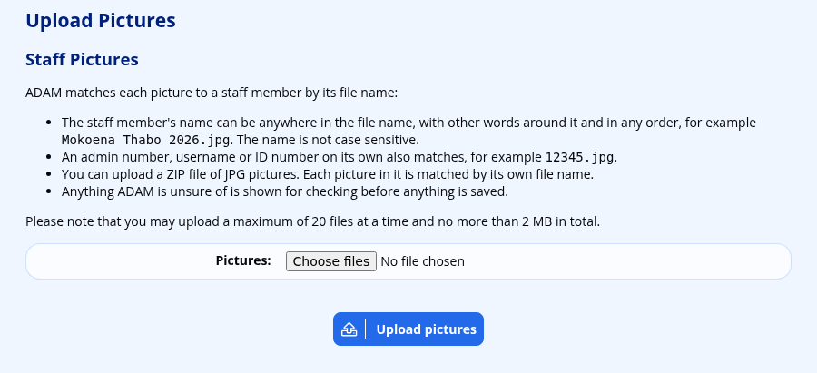
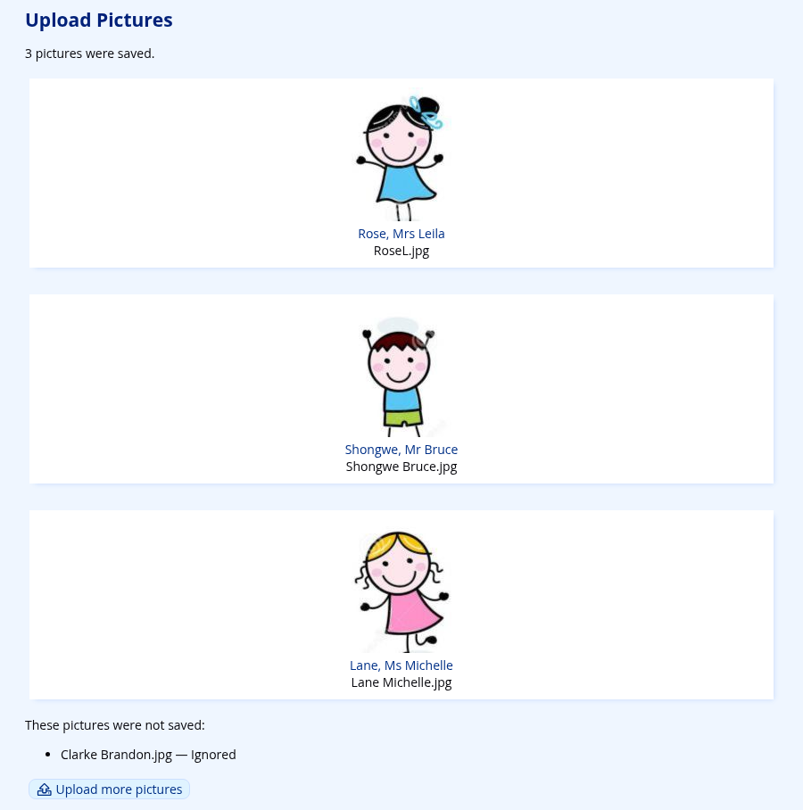

# Staff Photographs

ADAM stores staff photographs in the Document Repository and uses one of them as a primary display image for the staff member.

## Naming of Photographs

ADAM matches each picture to a staff member by its file name. The upload page lists these rules:

-   The staff member’s name can be anywhere in the file name, with other words around it and in any order. For example, `Mokoena Thabo 2026.jpg`. The name is not case sensitive.
-   An admin number, username or ID number on its own also matches. For example, `12345.jpg`.
-   You can upload a ZIP file of JPG pictures. Each picture in it is matched by its own file name.
-   Anything ADAM is unsure of is shown for checking before anything is saved.

The surname and first initial also work, separated by a space, such as `Clark B.jpg`. Without the space, as in `ClarkB.jpg`, ADAM shows the picture as **Probable** with the staff member selected, so that you check it once. After you confirm it, ADAM remembers it for you, and the same file name is certain next time. [How ADAM Matches a Name](matching-uploads-to-people.md#how-adam-matches-a-name) gives the full rules.

## Uploading Staff Photographs

Photographs can be uploaded for staff members by visiting **Staff → Names and Faces → Upload new staff photographs**. ADAM matches the pictures against current staff.

Click on the **Choose Files** button next to **Pictures**. A normal file selection window will appear. Click on a batch of files to upload, bearing in mind the limits that your server has in place. The page displays these limits for you — the maximum number of files you may upload at a time and the maximum total size — so you can select your batch accordingly. A ZIP file counts as one file. Click on the “Open” button at the bottom (this may differ depending on your web browser)

Click on the **Upload pictures** button. ADAM does not save anything yet. Files that are not JPG pictures are left out, and ADAM names them in a warning that starts “These files were not uploaded, because they are not JPG pictures or could not be read”.

ADAM then shows the review page, “Upload staff pictures”. Check the matches there, choose a staff member for each row that needs one or tick **Ignore**, and click **Confirm**. [Matching Uploads to People](matching-uploads-to-people.md#the-review-page) describes the review page.

After you confirm, ADAM saves the photographs and shows the results.

A line at the top says how many pictures were saved. Each saved picture is shown with the staff member’s name, which links to their profile, and the file name. Under the pictures, “These pictures were not saved:” lists each picture you ignored or that ADAM could not save, with the reason. The **Upload more pictures** link takes you back to the upload form.

*You do not have to upload all the files again, just the ones that were not saved.*

Now, when searching for a staff member or viewing their profile, their picture will be displayed:

## Manually Changing Photos

When using the upload feature described above, ADAM will automatically search for a staff member, place the photograph in that staff member’s Document Repository and set the staff member’s current photograph to use that version. However, in some instances, it may be preferable to perform some or all of these operations manually.

Some examples include:

-   A photograph was incorrectly named with the wrong person, but the staff member in question has no new photograph.

### Managing Photographs in the Document Repository

Visit the pupil’s information page (**Staff → Staff Administration → Staff Info**) and click on the **Document Repository** heading.

> [!WARNING]
> You will need specific permissions to be able to access the Document Repository.

Expand the **Photographs** section and use the **Choose Files** button to select a new photograph. Click on **Upload File…** to upload the file into the Document Repository.

> [!WARNING]
> One might also take this opportunity of removing any incorrect photographs.

Simply uploading a photograph to the document repository will *not* automatically change the photograph that ADAM displays. This must be done in a second step.

### Changing Which Photograph ADAM Displays

Navigate to **Staff → Names and Faces → Switch staff photograph**. Type in the name of the pupil whose photograph you’d like to change.

ADAM will show the current picture at the top and any other pictures that are available at the bottom. This includes the generic image. Simply click on a picture at the bottom to have it selected as the current photograph.
