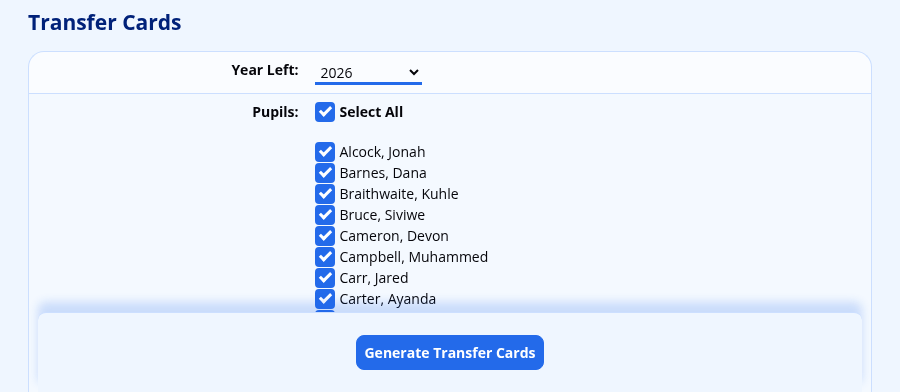
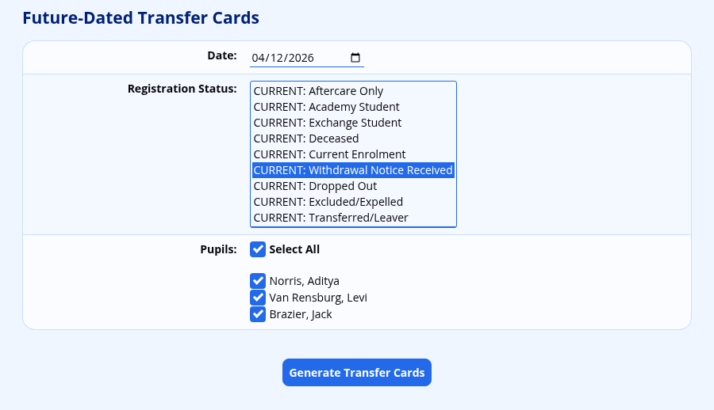
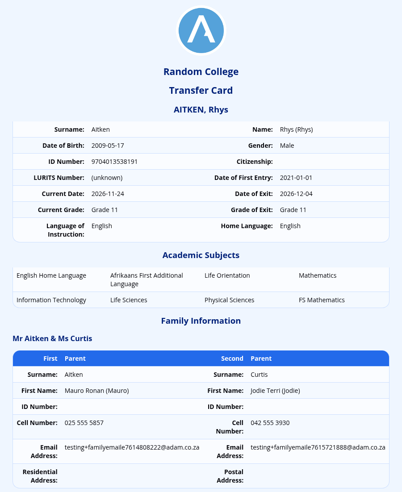
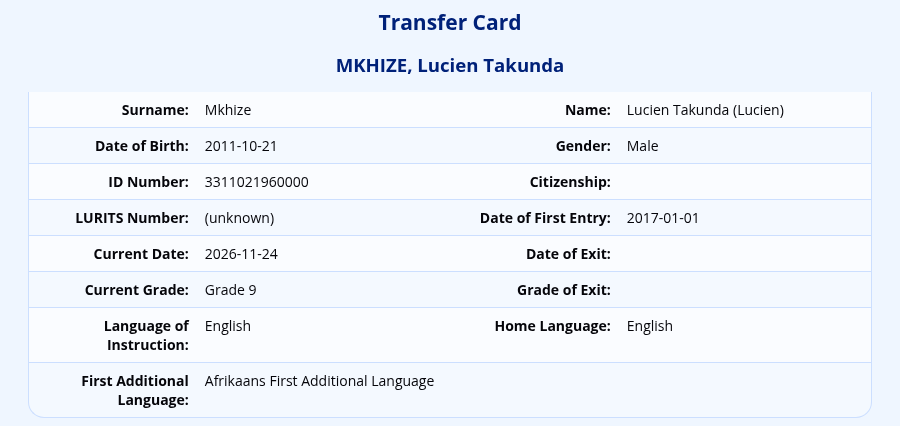

# Transfer Cards

A transfer card is a one-page summary of a pupil that the school prints when the pupil leaves for another school. It gives the pupil’s details, their subjects and their family’s contact details. Parents and pupils cannot see transfer cards.

## Who Can Print Transfer Cards

Printing transfer cards needs the **Generate Transfer Cards** permission, which is on the **Pupil Admin** tab under the **Registration** heading when [changing the permissions of a group](security-administration-for-staff.md#changing-the-permissions-of-a-group). Staff without it do not see the menu options or the link on a pupil’s information page.

## Printing Transfer Cards

There are three ways to print transfer cards:

-   [For pupils who have left](#for-pupils-who-have-left), chosen by the year they left.
-   [For pupils who are about to leave](#for-pupils-who-are-about-to-leave), chosen by their registration status.
-   [For one pupil](#for-one-pupil), from the pupil’s information page.

Each way opens the cards in a new tab, with one pupil on each printed page. Print them from that tab with your browser’s print option. If no pupil is ticked, the new tab shows “No pupils were selected. Please try again!”

### For pupils who have left

Navigate to **Alumni → Lists and Labels → Transfer Cards**.

1.  Choose the **Year Left**. The list offers each year in which pupils left the school, latest first.
2.  ADAM lists the pupils who left in that year, and ticks all of them. Untick any pupil who does not need a card. **Select All** ticks or unticks every pupil in the list.
3.  Click **Generate Transfer Cards**.

### For pupils who are about to leave

Navigate to **Alumni → Lists and Labels → Future-dated Transfer Cards**. The page is titled **Future-Dated Transfer Cards**.

1.  Enter the **Date** on which the pupils will leave. The card prints this date as the **Date of Exit**, and prints the grade the pupil will be in on that date as the **Grade of Exit**. If you leave the date empty, both are blank.
2.  Choose a **Registration Status**. Only the statuses for current pupils are listed. A school usually chooses the status it gives pupils who have given notice that they are leaving. ADAM lists the pupils who have that status, and ticks all of them. Choose one status at a time: if you select more than one, ADAM lists only the pupils with the first of them.
3.  Untick any pupil who does not need a card. **Select All** ticks or unticks every pupil in the list.
4.  Click **Generate Transfer Cards**.

### For one pupil

Navigate to **Pupils → Pupil Administration → Pupil Info** and find the pupil. On the **Admissions Record** tab, under **Registration Options**, click **Print a transfer card**.

For a pupil who has left, the card shows the date they left and the grade they left in. For a current pupil, the **Date of Exit** and **Grade of Exit** are blank. To print a card with these filled in for a pupil who is about to leave, use **Future-dated Transfer Cards**.

## What the Card Shows

This is the card of a Grade 11 pupil, printed from **Future-dated Transfer Cards**:

### Pupil details

The card starts with the school badge, the school’s name, the heading **Transfer Card** and the pupil’s name. A table then gives:

-   **Surname** and **Name**. The name is the pupil’s full first names, followed in brackets by the name the pupil is known by.
-   **Date of Birth**, **Gender**, **ID Number** and **Citizenship**.
-   **LURITS Number**, or “(unknown)” if the pupil has none.
-   **Date of First Entry**: the date the pupil first entered the school.
-   **Current Date**: the date the card was printed.
-   **Date of Exit** and **Current Grade**.
-   **Grade of Exit**: the grade the card describes (see below). It is blank for a pupil who is not leaving.
-   **Language of Instruction** and **Home Language**.
-   **First Additional Language**, for pupils in Grade 9 and lower only. See [First additional language](#first-additional-language).

The grade the card describes decides whether the card lists the pupil’s subjects or their first additional language:

-   For a pupil who has left, it is the grade the pupil left in.
-   For a card from **Future-dated Transfer Cards**, it is the grade the pupil will be in on the **Date** you entered. If the date is in the following year, this is the grade the pupil will be in that year.
-   For any other card, it is the pupil’s current grade.

### Academic subjects

A card for a pupil in Grade 10 or higher has an **Academic Subjects** section. It lists the academic subjects of the pupil’s most recent report. A pupil who has no reports yet is shown with their current academic subjects. The academic subjects are those in the **Academic Subject Category** site setting (see [Changing Site Settings](changing-site-settings.md)). Sport, cultural and other subjects are not listed.

### First additional language

A card for a pupil in Grade 9 or lower does not list subjects. It has a **First Additional Language** line instead, which names the pupil’s first additional language, for example “Afrikaans First Additional Language”:

ADAM recognises a first additional language from the subject’s **DBE Subject Link** (see [Editing a Subject](subjects.md#editing-a-subject)). It looks at the academic subjects of the pupil’s most recent report, or their current subjects if they have no reports, and names the first one linked to a DBE first additional language. If none of the pupil’s subjects is linked to one, the line is left off the card. A school whose language subject is not linked to a DBE first additional language should set the link on the subject.

### Family information

The **Family Information** section has a table for each of the pupil’s families, headed with the family’s name. For the first parent, and for the second parent if the family has one, it gives the parent’s **Surname**, **First Name**, **ID Number**, **Cell Number** and **Email Address**. A parent with more than one email address has all of them listed. The last row gives the family’s **Residential Address** and **Postal Address**.

## The School Badge

Navigate to **Administration → Site Administration → Edit site settings**, click on the **Pupils & Families** tab and scroll down to the **Scratch Lists** heading. Two settings control the badge at the top of each card:

-   **Display school badge?** prints the school badge at the top of each card. The default is **Yes**.
-   **The height of the school badge in pixels** sets the badge’s printed height. The default is 120.

These settings also apply to [scratch lists](scratch-lists.md). The badge is the school’s screen logo (see [School Logos](school-logos.md)).
