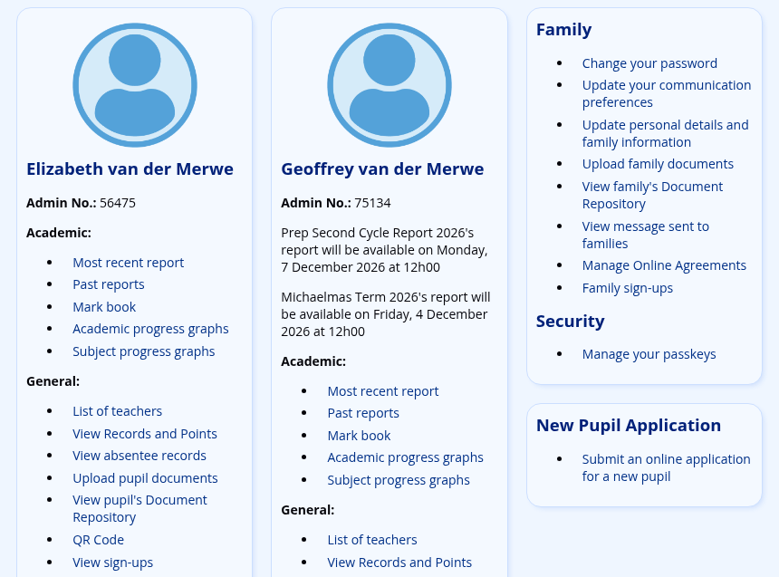
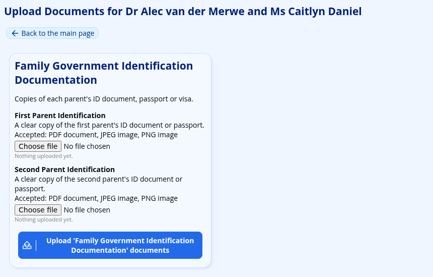

# Uploading Documents: A Guide for Parents and Pupils

**Your school may ask you to send it documents through ADAM, such as a copy of an ID document, a doctor’s note or a signed indemnity form. This guide explains how to upload those documents, what happens to them afterwards, and how to view documents that the school has shared with you.**

There are several sections in this guide. The following links will jump you to the one you need:

1.  [Finding the upload page](#finding-the-upload-page)
2.  [Uploading your documents](#uploading-your-documents)
3.  [What happens after you upload](#what-happens-after-you-upload)
4.  [Viewing documents the school has shared](#viewing-documents-the-school-has-shared)
5.  [Help! I can’t see the upload option!](#help-i-cant-see-the-upload-option)
6.  [Help! My document is too large!](#help-my-document-is-too-large)
7.  [Help! I uploaded the wrong document!](#help-i-uploaded-the-wrong-document)

## Finding the Upload Page

Log in to ADAM first. Parents use **Parent Login**; pupils use **Pupil Login**. See [Logging on to ADAM: A Guide for Parents](logging-on-to-adam-a-guide-for-parents.md#logging-on-to-adam-a-guide-for-parents) if you have not logged in before.

ADAM has two upload options. You will only see the ones that your school has switched on:

-   **Upload pupil documents** is for documents about one child. It appears on that child’s card, under the **General** heading. Parents see it on each child’s card. Pupils who log in themselves see it on their own card.
-   **Upload family documents** is for documents about the whole family, such as a parent’s ID document. It appears under the **Family** heading. Only parents see this option.

Click the option you need. ADAM opens a page called **Upload Documents for** followed by the child’s name or the family name. To return to the portal at any time, click **Back to the main page**.

## Uploading Your Documents

The upload page shows a box for each set of documents that the school has asked for. Each box has a title and a short explanation from the school. Inside each box is a list of documents. Each document has:

-   its name, in bold;
-   a description of what the school needs;
-   an **Accepted** line that lists the kinds of file you may upload, for example *Accepted: PDF document, JPEG image, PNG image*;
-   a **Choose file** button;
-   a short note on what you have already uploaded (see [What happens after you upload](#what-happens-after-you-upload)).

The school decides which documents to ask for, and the list can be different for each child. For example, a child who is applying to the school may be asked for different documents from a child who is already at the school. If the school has not asked for anything, ADAM shows the message *There are no upload slots available for document submissions here.*

All uploads are optional. You can upload some documents now and the rest later.

To upload documents:

1.  Click **Choose file** next to the document you want to send.
2.  Find the file on your computer or phone, and select it. You can choose one file for each document.
3.  Repeat for any other documents in the same box.
4.  Click the blue upload button at the bottom of that box. The button names the box, for example **Upload 'Sports Tour to Zimbabwe' documents**.

Each box has its own upload button, and that button sends only the files chosen in that box. If you have chosen files in two boxes, click both buttons, one after the other. Clicking one button reloads the page, which clears any files you have chosen in the other boxes but not yet uploaded.

When a file arrives safely, ADAM shows the message *The file '…' was uploaded successfully.* with the name of your file.

### If the File Type Is Not Accepted

You can only upload the kinds of file listed on the **Accepted** line. When you click **Choose file**, most browsers show only those kinds of file.

If you upload a file of another kind, ADAM does not save it. It shows a message naming the document, followed by *That file type is not accepted. Accepted types:* and the list of accepted types. Save or scan your document as one of the accepted types and upload it again. If you cannot do this, contact the school.

### If the File Is Too Large

Each document has a size limit, set by the school. If you choose a file that is larger than the limit, ADAM may warn you straight away with a message titled **Document is too large.** that tells you the limit in MB:

Click **Okay**. The upload button for that box is now greyed out and reads **Documents too large...** until you fix the problem. To fix it, click **Choose file** again and choose a smaller file. In some browsers, you can also click **Cancel** in the window that opens to clear the file without choosing another one.

If ADAM does not warn you straight away, it checks the size when you click the upload button. A file that is too large is not saved, and ADAM shows a message naming the document, followed by *The file was too large. A limit of … MB was set.*

> [!NOTE]
> If one file in a box is rejected, the other files that you chose in the same box are still uploaded. Check the messages at the top of the page to see which files arrived.

## What Happens After You Upload

Your document does not go straight onto your child’s or your family’s record. A staff member at the school checks each document first, and then accepts or rejects it.

Below each **Choose file** button, ADAM shows the status of that document:

-   *Nothing uploaded yet.* — you have not uploaded anything for this document.
-   *Last uploaded …* — when you last uploaded a file for this document, for example *Last uploaded 2 hours ago.*
-   *There is 1 uploaded document that has yet to be reviewed.* — the school has not yet looked at your file. If you have uploaded more than one file for the same document, ADAM tells you how many are still waiting.
-   *All uploaded documents have been reviewed.* — the school has dealt with everything you uploaded for this document.

The status does not tell you whether the school accepted or rejected your file. If you need to know, contact the school.

If you upload a second file for the same document, ADAM does not replace the first one. It keeps both, and the school reviews each one separately.

## Viewing Documents the School Has Shared

Some schools also let you view documents that are stored against your child or your family, such as reports or letters. If your school has switched this on, you will see:

-   **View pupil's Document Repository** on each child’s card, under the **General** heading. Pupils who log in themselves see it on their own card.
-   **View family's Document Repository** under the **Family** heading. Only parents see this option.

The page lists the documents in sections, with the number of files in each section. Click a section to open it, and then click a file’s name to download it.

The school decides which sections you can see. A document that you uploaded will only appear here if the school has accepted it and has given you access to the section it was filed in.

## Help! I can’t see the upload option!

The upload options only appear if your school has switched them on, and only if your school has asked for documents from you. If you expected to see an upload option and it is not there, please contact the school.

Kindly note that the developers of ADAM cannot assist with the resolution of this issue.

## Help! My document is too large!

Here are some ways to make a file smaller:

-   If you took a photo of the document, take it again at a lower resolution, or crop it so that it shows only the document.
-   If you scanned the document, scan it again in black and white or at a lower resolution.
-   If the document has many pages, check whether the school needs all of them.

If you still cannot get the file under the limit, please contact the school.

## Help! I uploaded the wrong document!

You cannot delete a file once you have uploaded it. Contact the school and tell them which file is wrong, so that they can reject it. Then upload the correct file.
