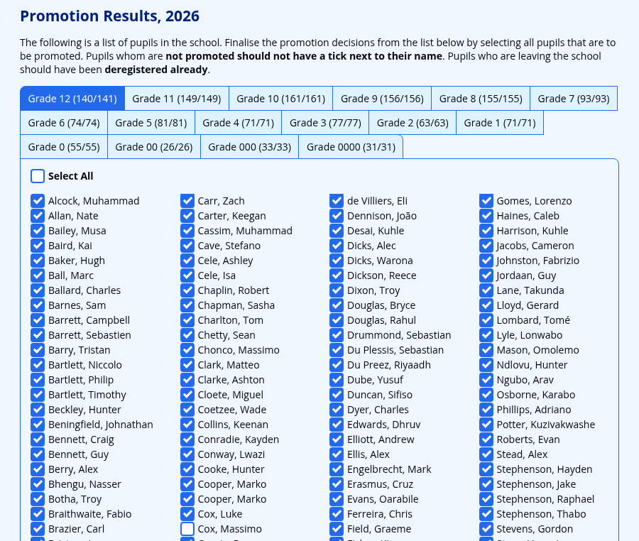
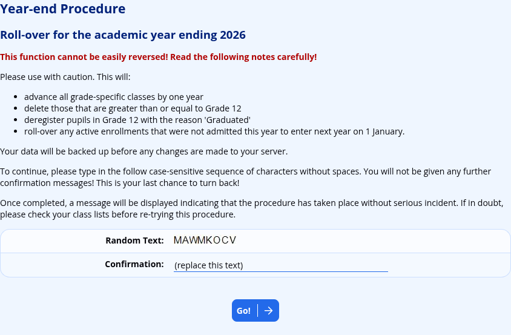
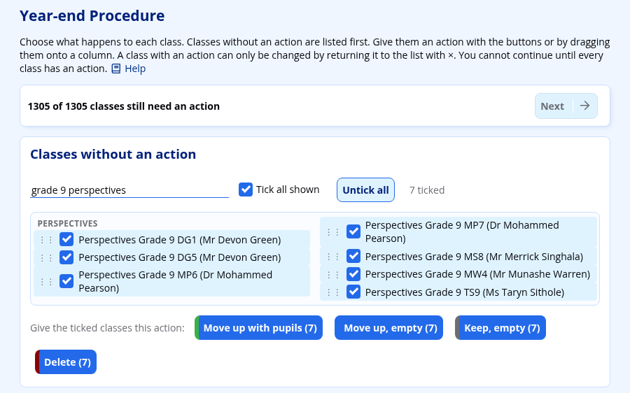
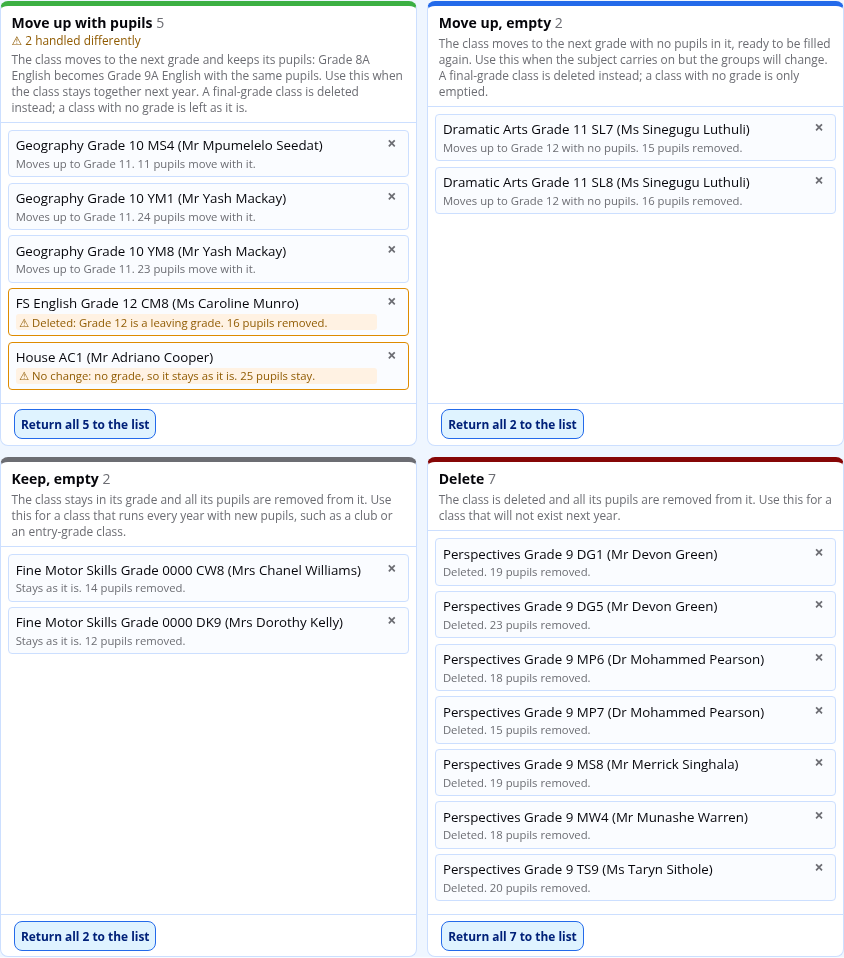
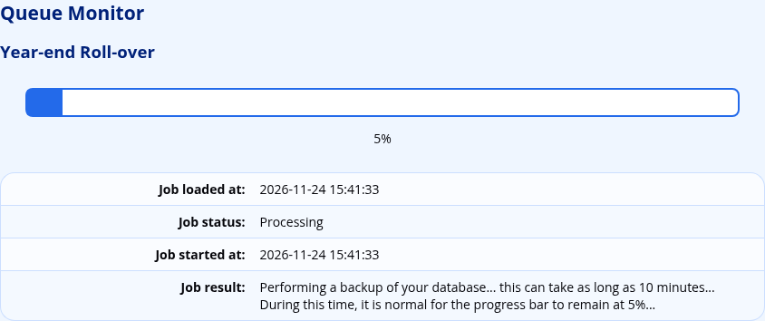

# Year-end Functions

The following video provides a walk through of the process. Each step is also described below.

https://www.youtube.com/watch?v=HsoeHjKWUcw

## Before You Begin

Please ensure that your ADAM installation meets the following requirements:

-   **Ensure that there are no open [reporting periods](reporting-period-administration.md#reporting-period-administration).** ADAM will warn you during the upgrade if there are any open. In particular, check that the reporting **period end-date** has passed and that the reporting period is **published**.
-   **Download a copy of your [SA-SAMS database](roll-calls.md#roll-calls)** before you proceed with the roll-over. Most provinces require a submission of the SA-SAMS database at year-end. Now is a good time to download it before you change any pupil registrations.
-   **The roll-over process will affect your class lists.** Until you have an opportunity to add in your classes for the following year, we suggest that you temporarily [remove the permission which allows pupils and families to see a list of teachers](security-administration-for-families-and-pupils.md#security-administration-for-families-and-pupils) in the pupil and parent portal. This will, of course, depend on how you perform the roll-over and which options you choose when processing your classes below.
-   **Check your graduating grades.** ADAM allows for a school to have multiple exit points. These are defined by the [graduating grades](grade-settings.md#grade-settings). During the roll-over, any pupil in a graduating grade is moved to the alumni status.

## Step 1: Process any Transferring Students

Once your academic year is over, it is time to process the pupils who are leaving the school for any reason *other than graduation* from last year offered by your school. If you are a primary school, for example, then this would exclude your Grade 7 learners and, if you are a high school, this would exclude your Grade 12 learners. ADAM takes care of graduating pupils separately and automatically.

If you **don’t know** which pupils might be transferring, don’t worry: deregistering pupils can be done later and their date of leaving set retroactively. You can deregister a pupil at any time using this same process.

-   On the **Pupils** tab, click on **Pupil Info** which is found under the **Pupil Administration** heading and search for the pupil to be deregistered.
-   Once their profile is loaded, click on the **Admissions Records** section within their profile.
-   Choose the option to **Deregister current pupil now**.

-   Choose a reason for their exit and enter a note if you’d like to record more detail about why they have left.
-   **Please ensure that you do not choose the last day of term as date of deregistration.** If you do, ADAM will consider the pupil as not reaching the last day of term. The date of their deregistration should be their first day NOT at the school!

Repeat these steps for each transferring pupil.

## Step 2: Finalising Promotion Decisions

This step tells ADAM which pupils should be moved up into the next grade and which pupils should not be. Although ADAM can calculate promotion decisions based on results, these calculated decisions may not always reflect accurate promotions and transfers to subsequent grades. For this reason, ADAM asks you to check which pupils must be moved to the next grade, and which should be kept in the same grade.

ADAM starts with every pupil ticked, which means that every pupil will be promoted unless you untick them. The promotion decision calculated by ADAM’s promotion results is only a guide and is not used here: a pupil who reflects “Fail” in their promotion decision is still ticked until you untick them.

Additionally, if a decision regarding a pupil’s promotion is made only after the roll-over is complete, don’t worry: it is possible to change the promotions later. Changing it after the roll-over requires a [slightly more manual approach](pupil-information.md#how-adam-works-out-a-pupils-grade) which is otherwise automated in the roll-over process.

-   On the **Administration** tab, click on **Finalise promotion results** under the **Year-end Functions** heading.
-   Choose the **Academic Year** to process and click on **Next**. ADAM allows you to choose a previous year, but this *should only be used in special circumstances and under guidance from support staff!* For a standard end-of-year procedure, you will always choose the year of the academic cycle just past.

-   ADAM lists the pupils in the school, with a tab for each grade. Each tab shows how many of its pupils are ticked: “Grade 12 (140/141)” means that 140 of the 141 pupils in Grade 12 will be promoted. Untick each pupil who is being held back a year. **Select All**, at the top of each tab, ticks or unticks every pupil in that grade.

-   Click on the **Save Promotion Decisions** button, at the bottom of the page, to record these changes. It is possible to come back and change these promotion decisions, but all changes must be completed before moving to Step 3, below.
-   ADAM shows the page again, with a list of the pupils who are NOT progressing to a higher grade above the tabs. Double check this list and, if necessary, change the ticks and save again to ensure that the correct pupils are promoted.

## Step 3: The Roll-Over

The largest and most important aspect of the roll-over is telling ADAM how to help you simplify the process of creating new classes for the following academic year.

### Background Information

ADAM will ask you what it should do with each of the classes that you have created on your system for the current academic year. There are four possible actions:

1.  **Move up with pupils** moves the class to the next grade and keeps its pupils in it.

Using this action will cause “Grade 8 C English” to become “Grade 9 C English” and all the pupils that were in “Grade 8 C English” will now be in “Grade 9 C English”.

Use this action if the class will remain largely the same from year to year, even if the teacher will change.

2.  **Move up, empty** moves the class to the next grade and removes all its pupils from it. This is useful when the subject will be carried through to the following year but the class groups will change significantly.

Using this action will cause “Grade 8 C English” to become “Grade 9 C English”, but the pupils who were in “Grade 8 C English” will no longer be registered for an English class. “Grade 9 C English” will still have the same teacher, but none of the pupils.

3.  **Keep, empty** leaves the class in its grade and removes all its pupils from it.

Using this action will cause “Grade 8 C English” to remain as “Grade 8 C English” and all the pupils who were registered for “Grade 8 C English” will no longer be registered for an English class.

Use this action if you have the same classes with the same teachers in the same grades each year, or for a class that runs every year with new pupils, such as a club. This is mostly used with Primary Schools.

4.  **Delete** deletes the class and removes all its pupils from it.

The following table summarises these four actions:

| Action | Keeps the class and the teacher | Changes the grade of the class | Keeps the pupils in the class |
|---|:-:|:-:|:-:|
| Move up with pupils | Yes | Yes | Yes |
| Move up, empty | Yes | Yes | No |
| Keep, empty | Yes | No | No |
| Delete | No | No | No |

Two kinds of class are treated differently from what the action’s name suggests:

-   **A class in a leaving grade.** A class in the final grade of the school, or in any other [graduating grade](grade-settings.md#grade-settings), has no grade to move up to. If you choose either “Move up” action for it, ADAM deletes it instead.
-   **A class that is not assigned to a grade**, such as a sports house or a school club. It cannot move up. “Move up with pupils” leaves it exactly as it is, with all its pupils, and “Move up, empty” only removes its pupils, which is the same as “Keep, empty”.

You do not need to remember these rules: ADAM marks each of these classes with a ⚠ when you choose its action, and says what will happen to it.

The following examples might provide some context for when to use the different actions:

-   In a high school, subjects like “Geography” and “History” in Grades 10 and 11 usually keep the same enrolments from year to year. These classes would be given “Move up with pupils” to merely change the class grade, but keep the pupils enrolled. If the teacher changes, this could be done later.

-   If the class is going to change significantly in its make up, it might help to have a new, empty class ready in the following grade, but to remove the pupils from it which will allow them to be entered into new classes. In this scenario, choose “Move up, empty”. *This action is chosen least often. This is not to say that it is* never *chosen, but you are probably doing something inefficient if you choose it for most of your classes!*
-   In primary schools, class teachers generally remain the same in each grade. It may thus be best to choose “Keep, empty”. This will keep the classes for a particular grade, but deregister the pupils who will have moved up to the next grade.

-   Finally, any class which does not need to be taken into account in the following year should be given “Delete”.

### Performing the Roll-over

-   On the **Administration** tab under the **Year-end Functions** heading, click on the **Perform year-end functions** option.
-   If ADAM detects any problems at this point, you will be notified. Common problems include:

1.  Having a reporting period still open. All reporting periods must be closed and finalised. Ideally, the publishing date should also have passed.

2.  Not having processed the promotions yet (see [Step 2](#step-2-finalising-promotion-decisions)).

3.  Having already performed the roll-over for the year.

If, however, ADAM gives you the option of entering in a random string of capital letters to proceed with the roll-over, then your system has met all the requirements.

-   Type the random characters into the **Confirmation** box and click on the “**Go!**” button.

-   ADAM now lists the classes that do not have an action yet, under **Classes without an action**, grouped by subject. To begin with, this is every class in the school: ADAM gives no class an action until you choose one.

-   To give classes an action, tick them and click on the button for the action, next to **Give the ticked classes this action:**. Each button shows how many classes are ticked. You can also drag a class, or a group of ticked classes, onto one of the four boxes below the list.
-   To deal with many classes at once, type in the filter box. ADAM then shows only the classes whose names contain every word that you have typed, for example **grade 12** or **grade 9 perspectives**. Tick **Tick all shown** to tick every class in the filtered list, and click on the action. Each word matches any part of a class’s name, including its description and its teacher, so **grade 1** also shows the Grade 10, 11 and 12 classes. Add more words to narrow the list.
-   Once a class has an action, it leaves the list and appears in the box for that action, so filtering and ticking again cannot change it by accident. Each box explains its action, and each class in a box shows what will happen to it, for example “Moves up to Grade 11. 24 pupils move with it.” A class that will be treated differently from the box’s name is marked with a ⚠, such as “⚠ Deleted: Grade 12 is a leaving grade.”, and the box’s heading counts how many of its classes are marked.

-   To change your mind about a class, click on the **×** next to it, or on **Return all** at the bottom of its box to return every class in that box. The classes go back to the list, where you can choose again.
-   ADAM remembers your choices in this browser, so you can reload the page or come back to it later. When it restores earlier choices, it says so at the top of the page and offers a **Start again** button, which clears every action.
-   The bar at the top of the page counts the classes that still need an action, and the **Next** button is not available until every class has one. Once the bar reads “Every class has an action. You can continue.”, you are ready for the final step in this process. Click on the “**Next**” button.

-   At this point, **ADAM creates a backup of the database** and, once done, performs the required operations on the classes and processes the promotions and graduations. A progress page shows how far it has got. The backup can take as long as 10 minutes, during which it is normal for the progress bar to remain at 5%. Please be patient! If you end up waiting for much longer than this, please contact us!

-   When the roll-over is finished, ADAM reports “Congratulations! Your roll-over is complete.”

ADAM does not start the roll-over, and explains why, if:

-   a roll-over is already in progress, for example because **Back** was clicked during the backup. ADAM offers a link to the roll-over’s progress instead;
-   the roll-over for that year has already been completed;
-   the classes have changed since the page was loaded, for example because someone else added a class. Start the year-end procedure again;
-   a backup of the database could not be made.

Once ADAM has completed the roll-over, you will notice that as you work your way back to the menu and into other functions in ADAM, ADAM will report that it is in “**Roll-over mode**”. This happens only if the roll-over was completed before the end of the calendar year. If the roll-over is performed at the start of the next calendar year (in January), then ADAM will not enter the roll-over mode. “Roll-over mode” stops automatically on 1 January when normal operation can resume.

In roll-over mode, ADAM will assume that the date for a number of operations is 1 January of the following year. This allows you to start working on your classes.

## Step 4: Processing New Admissions

New admissions to the school need to be registered as current pupils in order that they can be registered into classes.

-   On the **Admissions** tab, under the **Pupil Administration** heading, click on the **Process admissions and enrolments** option.
-   ADAM will show a list of pupils waiting to be admitted into the school for that year.

-   Note that if someone’s admissions date is set for the following year, in error perhaps, then they will not show up on this list until their entry date has been changed. This can be done by visiting the **Pupil Info** page and clicking on their **Admissions Records**. There should be an option to change their entry date.

-   Any pupils whose entry dates have passed are automatically selected, but other pupils can also be selected to enrol. These pupils will have their entry dates change to the current date. If ADAM is in roll-over mode, this will automatically be 1 January.

-   Click on “**Enrol pupils**” at the bottom of the screen to process the enrolments.

-   ADAM will show a list of pupils that have been enrolled.

## Step 5: Create a Term 1 Reporting Period

**Please do this step as part of your roll-over! Don’t leave it until later!**

Until a new reporting period is created, you may find that each pupil, in the search menus, will still have their default class from the year before showing. This can be disconcerting since this often will include the incorrect grade.

In addition, when messaging pupils, ADAM will look to the last class registration that coincided with a reporting period (which, if you like, “confirms” the registration). Without a reporting period created for the new year, the last reporting period will have last year’s classes and - importantly - include any children that might have left and ignore and new pupils that may have arrived.

As soon as a reporting period is created, ADAM will be able to accurately determine the correct – and new – class information to show in that search list.

-   On the Reporting tab, click on the Add reporting period option under the Reporting Period Administration heading.

-   Enter the name, short name and the start and end dates of the reporting period. If you know the rest of the information, then you can add that in also, but it can always be updated later.

## Step 6: Update Class Registrations and Class Details

This final step is to ensure that the class registrations are accurate for the following year.

1.  Add new classes – especially for junior grades if the classes were “moved up” as part of the roll-over procedure.

2.  Edit details of classes where teachers or class descriptions might change.

3.  Enrol pupils into the classes as required.

If you need any help with the year-end procedure, email help is available throughout December with a 24-hour turnaround on requests. Telephonic support may be available, but unfortunately cannot be guaranteed during this holiday time.

---
